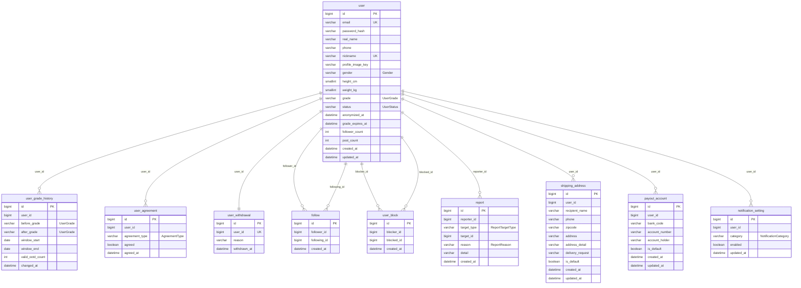
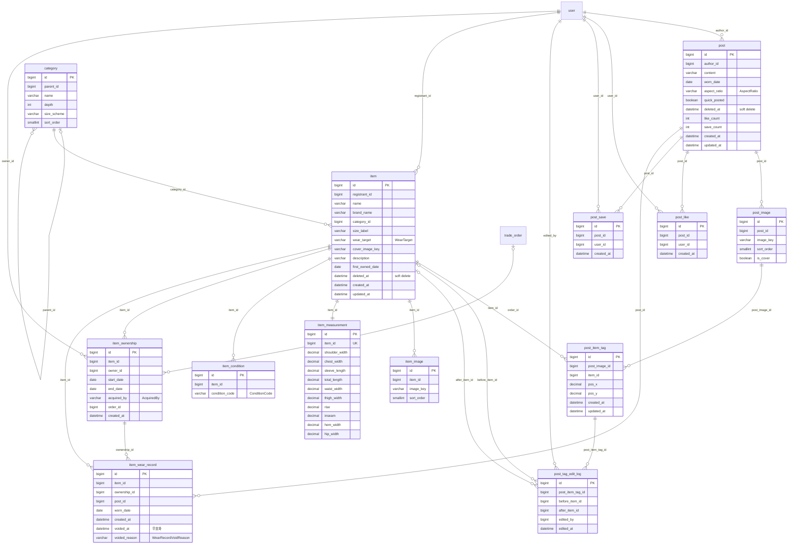
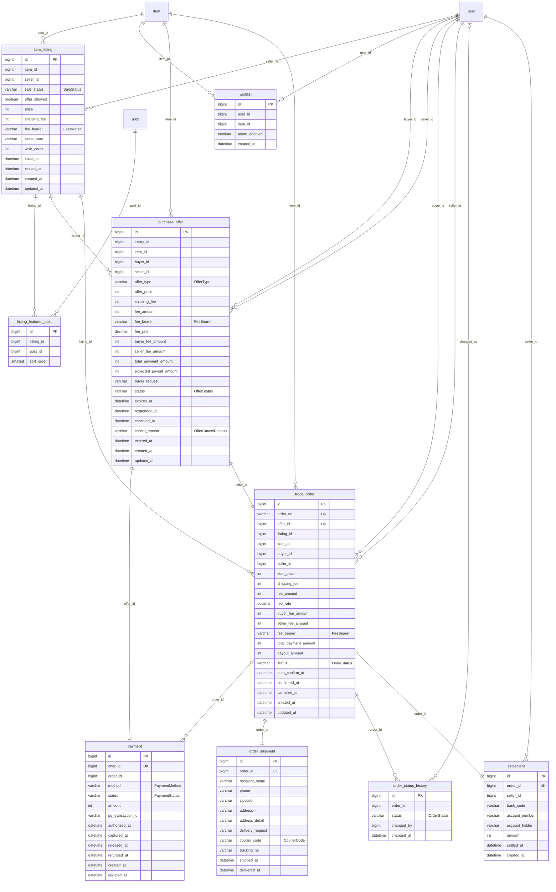
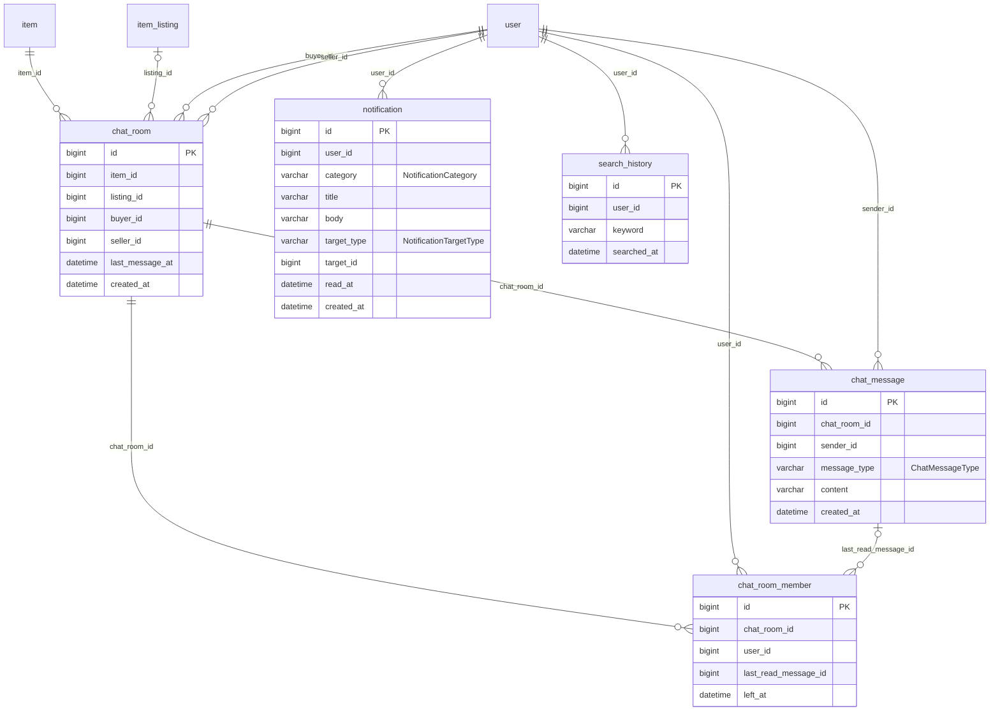

# Tenure ERD — v3

> **피그마** [Tenure UXUI 작업](https://www.figma.com/design/hnEDDkiI0V4js9JzWR2l2M/Tenure-UXUI-%EC%9E%91%EC%97%85?node-id=813-8486&m=dev)
> **범위** 캔버스 `2. 최종 UI`(`813:8486`) 33개 섹션 전체. 보조로 `4. 랜딩페이지`(`5359:57698`)의 서비스 IA·거래 플로우
> **생성일** 2026-09-24 · **DB** MySQL 8 · **테이블** 37개 · **컬럼** 304개
> **정본** [`schema.yaml`](./schema.yaml) — 이 문서의 §2 관계 요약표, §4 화면 인벤토리, §5 컬럼 명세는 정본에서 생성된다

---

## 1. 서비스 이해

**Tenure — "입었던 기록을 남기고, 판매할 때 옷의 가치를 보여주다"**

OOTD 사진을 올리면 사진 속 옷에 아이템 태그가 붙는다. 그 태그가 쌓여 아이템의 **실착 이력**이
되고, 판매 시점에 이 이력이 상품 가치의 근거가 된다. 거래가 끝나면 기록은 구매자에게 승계된다.

> "구매자는 아이템의 기록을 이어서 받게됩니다.
>  — 실착 이력, 공개 OOTD 연결, 소유자 히스토리, 판매 재등록 시 이전 기록"
> — 명세된 구매 제안서

### 1.1 데이터 모델의 축

일반적인 중고거래 앱이라면 "상품"이 거래마다 새로 생기는 게시글이다. Tenure는 다르다.
**아이템은 거래를 넘어 존속하는 개체이고, 판매 등록이 그 아이템에 붙었다 떨어지는 부속물이다.**

```
item (불변, soft delete)
 ├─ item_ownership   ── 소유 구간이 행으로 쌓인다 (25.02.8~26.07.10 → 26.07.10~현재)
 ├─ item_wear_record ── 착용 기록이 소유 구간에 귀속된다 (OOTD 인증 8회 / 12회)
 └─ item_listing     ── 판매 등록은 재판매마다 새로 생긴다 (1:N)
```

이 구조가 상품 상세의 **"Tenure 기록 기준"** 섹션을 그대로 표현한다:

| 소유자 | 보유 기간 | 착용 기록 | |
|---|---|---|---|
| 유진나라 | 26.07.10 ~ 현재 | OOTD 인증 12회 | |
| 소소한 행복 | 25.02.8 ~ 26.07.10 | OOTD 인증 8회 | `최초 등록` |

`item_ownership` 과 `item_wear_record` 는 **0순위 테이블**이다 — 비워지면 "기록 승계"라는
서비스의 핵심 가치가 즉시 깨진다. 따라서 둘 다 `append-only` 이며, 이들을 가리키는 FK 와
이들이 가리키는 FK 는 전부 `RESTRICT` 다.

### 1.2 거래 파이프라인

```
구매 제안 ──(결제 승인 임시 확보)──▶ 응답 대기 ──24h 만료──▶ 자동 취소
                                        │
                                   판매자 수락 (최종 결제)
                                        ▼
  결제 완료 ─▶ 상품 발송 ─▶ 배송 완료 ─▶ 구매 확정 ─▶ 정산 완료 ─▶ 거래 완료
            (운송장 입력)            (72h 자동 확정)          │
                                                         └─▶ item_ownership 승계
```

**결제가 주문보다 먼저 생긴다.** 일반적인 흐름과 순서가 반대다.

> "결제 승인이 임시로 확보되었습니다. 판매자가 수락하면 최종 결제되며,
>  거절·취소·만료 시 승인이 해제됩니다."

구매자가 제안을 보낼 때 이미 승인이 잡히고, 판매자가 수락해야 `trade_order` 가 생긴다.
그래서 `payment.offer_id` 는 NOT NULL 이고 `payment.order_id` 는 nullable 이다.

### 1.3 v2에서 바뀐 것

| # | 변경 | 근거 |
|---|---|---|
| 1 | `item` 에 soft delete 도입 | 태그된 아이템 목록에 `삭제된 아이템` 상태가 실재한다. v2의 "아이템 삭제 UI 없음" 판단이 틀렸다 |
| 2 | `post` 에 soft delete 도입 | `listing_featured_post.post_id` 가 RESTRICT라 게시물 삭제가 DB에서 실패하던 버그 |
| 3 | 0순위 CASCADE 3건 제거 | `item_ownership.item_id`, `item_wear_record.item_id`, `order_status_history.order_id` |
| 4 | 사람(`user`) 참조 CASCADE 6건 제거 | 30개 FK 전부 RESTRICT 단일 정책으로 통일 |
| 5 | `user_grade_history` 신설 | `UserGrade.RECORD` 승격 사실을 기록할 자리가 없었다 |
| 6 | `recent_view` 신설 | `최근 본 사용자`, `방금 보신 OOTD와 유사한 게시물` 추천의 입력. **v3 에서 Redis 로 옮겨 테이블은 없앴다**(`DEC-014`) |
| 7 | `purchase_offer` append-only 고정 | 행이 지워지면 "제안 기회 복구 안 됨" 규칙이 무력화된다 |
| 8 | `OfferStatus`·`PaymentStatus` 값별 시각 컬럼 분리 | 취소/거절/만료/환불을 구분할 자리가 없었다 |
| 9 | 카테고리 대분류 10종 확정 | `아이템 상세 수정/*` 프레임 10개 |
| 10 | 대표 OOTD 상한 5개 확정 | `대표 OOTD 최대 5개 선택 화면` |

---
### 1.4 모델링 패턴

구조에 이름을 붙여 둔다. 다음 사람이 의도를 읽을 수 있어야 한다.

| 패턴 | 테이블 | 요점 |
|---|---|---|
| **유효 구간 (temporal validity)** | `item_ownership` | `start_date`/`end_date`, `end_date IS NULL` 이 현재 구간. 구간이 겹치지 않아야 하며 append-only |
| **이력 테이블 (audit trail)** | `user_grade_history`, `post_tag_edit_log`, `order_status_history` | `before_*`/`after_*` + `changed_by` + `changed_at`. `changed_by` 가 NULL 이면 시스템 변경. 항상 append-only |
| **단일 테이블 상속 (STI)** | `purchase_offer` | `offer_type` 으로 두 유형을 한 테이블에. 생명주기와 화면 구성이 거의 같고 목록에서 함께 조회되기 때문 |
| **자기 참조** | `category` | `parent_id` nullable, `depth` 로 2단 고정. 하위가 있으면 `RESTRICT` |
| **다형 참조 (polymorphic)** | `report`, `notification` | `target_type` + `target_id`. **FK 를 걸 수 없어** DB 가 무결성을 보장하지 못한다 → §6-1 에서 대상 삭제 처리를 정했다 |

---

## 2. 관계 요약표

> mermaid 보다 먼저 온다. **여기 없는 선은 다이어그램에도 없다.**
> `0순위`는 "이 테이블이 비워지면 서비스의 핵심 가치가 깨지는가"에 해당하는 관계다. `✓`면 ON DELETE 는 반드시 `RESTRICT`다.

| # | From | To | 카디널리티 | FK | 필수 | ON DELETE | 성격 | 0순위 | 근거 |
|---:|---|---|---|---|:--:|---|---|:--:|---|
| 1 | `user_grade_history` | `user` | N:1 | `user_id` | O | `RESTRICT` | 원장 | ✓ | 등급 변경 이력. 사람 FK + 활동 기록이라 CASCADE 금지 |
| 2 | `user_agreement` | `user` | N:1 | `user_id` | O | `RESTRICT` | 원장 | ✓ | 회원가입 > 동의 받기. 약관 동의는 법적 증빙이라 연쇄 삭제 금지 |
| 3 | `user_withdrawal` | `user` | 1:1 | `user_id` | O | `RESTRICT` | 원장 | ✓ | 회원탈퇴 사유. 탈퇴 이력은 감사 대상 |
| 4 | `follow` | `user` | N:1 | `follower_id` | O | `RESTRICT` | 참조 |  | 사람을 가리키는 FK. CASCADE 금지 |
| 5 | `follow` | `user` | N:1 | `following_id` | O | `RESTRICT` | 참조 |  | '팔로워 - 팔로잉 화면'. 사람 FK |
| 6 | `user_block` | `user` | N:1 | `blocker_id` | O | `RESTRICT` | 참조 |  | 차단한 사용자. 사람 FK |
| 7 | `user_block` | `user` | N:1 | `blocked_id` | O | `RESTRICT` | 참조 |  | '이 사용자를 차단할까요?'. 사람 FK |
| 8 | `report` | `user` | N:1 | `reporter_id` | O | `RESTRICT` | 원장 | ✓ | 신고 이력. 사람 FK + 감사 대상 |
| 9 | `shipping_address` | `user` | N:1 | `user_id` | O | `RESTRICT` | 소유 |  | 성격은 소유지만 사람을 가리키는 FK라 RESTRICT. 탈퇴 시 애플리케이션이 명시적으로 삭제한다 |
| 10 | `payout_account` | `user` | N:1 | `user_id` | O | `RESTRICT` | 소유 |  | 성격은 소유지만 사람 FK + 금액 관련이라 RESTRICT |
| 11 | `notification_setting` | `user` | N:1 | `user_id` | O | `RESTRICT` | 소유 |  | 성격은 소유지만 사람 FK라 RESTRICT. 탈퇴 시 명시적 삭제 |
| 12 | `post` | `user` | N:1 | `author_id` | O | `RESTRICT` | 참조 |  | 작성자. 사람 FK라 CASCADE 금지 |
| 13 | `post_image` | `post` | N:1 | `post_id` | O | `RESTRICT` | 소유 |  | 성격은 소유지만 Post 가 soft delete(A분류)라 RESTRICT 로 고정. Post 는 물리 삭제되지 않는다 |
| 14 | `post_item_tag` | `post_image` | N:1 | `post_image_id` | O | `CASCADE` | 소유 |  | 사진 밖에서 좌표는 의미가 없다. PostImage 는 하드 삭제 대상이므로 CASCADE 가 유효하게 동작한다 |
| 15 | `post_item_tag` | `item` | N:1 | `item_id` | O | `RESTRICT` | 참조 |  | Item 이 soft delete(A분류)라 RESTRICT. '삭제된 아이템'으로 표시하려면 태그가 남아야 한다 |
| 16 | `post_like` | `post` | N:1 | `post_id` | O | `RESTRICT` | 소유 |  | Post 가 soft delete(A분류)라 RESTRICT |
| 17 | `post_like` | `user` | N:1 | `user_id` | O | `RESTRICT` | 참조 |  | 사람 FK |
| 18 | `post_save` | `post` | N:1 | `post_id` | O | `RESTRICT` | 소유 |  | Post 가 soft delete(A분류)라 RESTRICT |
| 19 | `post_save` | `user` | N:1 | `user_id` | O | `RESTRICT` | 참조 |  | 사람 FK |
| 20 | `post_tag_edit_log` | `post_item_tag` | N:1 | `post_item_tag_id` | O | `RESTRICT` | 원장 | ✓ | 수정 이력은 활동 기록. CASCADE 금지 |
| 21 | `post_tag_edit_log` | `item` | N:1 | `before_item_id` | - | `RESTRICT` | 선택적참조 |  | 변경 전 아이템 |
| 22 | `post_tag_edit_log` | `item` | N:1 | `after_item_id` | - | `RESTRICT` | 선택적참조 |  | 변경 후 아이템 |
| 23 | `post_tag_edit_log` | `user` | N:1 | `edited_by` | O | `RESTRICT` | 참조 |  | 사람 FK |
| 24 | `category` | `category` | N:1 | `parent_id` | - | `RESTRICT` | 선택적참조 |  | 2단 자기참조. 하위가 있으면 상위 삭제 금지 |
| 25 | `item` | `category` | N:1 | `category_id` | O | `RESTRICT` | 참조 |  | 마스터 데이터 참조 |
| 26 | `item` | `user` | N:1 | `registrant_id` | O | `RESTRICT` | 참조 |  | 최초 등록자. 사람 FK |
| 27 | `item_image` | `item` | N:1 | `item_id` | O | `RESTRICT` | 소유 |  | 성격은 소유지만 Item 이 soft delete(A분류)라 RESTRICT |
| 28 | `item_measurement` | `item` | 1:1 | `item_id` | O | `RESTRICT` | 소유 |  | 아이템당 실측 1행. Item 이 soft delete(A분류)라 RESTRICT |
| 29 | `item_condition` | `item` | N:1 | `item_id` | O | `RESTRICT` | 소유 |  | Item 이 soft delete(A분류)라 RESTRICT |
| 30 | `item_ownership` | `item` | N:1 | `item_id` | O | `RESTRICT` | 원장 | ✓ | 0순위 — 소유 이력은 승계의 근거. v2 의 CASCADE 를 바로잡았다 |
| 31 | `item_ownership` | `user` | N:1 | `owner_id` | O | `RESTRICT` | 원장 | ✓ | 이전 소유자 닉네임이 화면에 남아야 한다. 사람 FK |
| 32 | `item_ownership` | `trade_order` | N:1 | `order_id` | - | `RESTRICT` | 선택적참조 |  | AcquiredBy.TRADE 의 근거 거래 |
| 33 | `item_wear_record` | `item` | N:1 | `item_id` | O | `RESTRICT` | 원장 | ✓ | 0순위 — 'OOTD 인증'은 집계의 원천. v2 의 CASCADE 를 바로잡았다 |
| 34 | `item_wear_record` | `item_ownership` | N:1 | `ownership_id` | O | `RESTRICT` | 원장 | ✓ | 소유 구간별 인증 횟수 집계 단위 |
| 35 | `item_wear_record` | `post` | N:1 | `post_id` | O | `RESTRICT` | 원장 | ✓ | Post 가 soft delete 라 링크가 끊기지 않는다. v2 의 nullable+SET NULL 이 불필요해졌다 |
| 36 | `item_listing` | `item` | N:1 | `item_id` | O | `RESTRICT` | 참조 |  | 아이템은 여러 번 재판매된다. Item 이 soft delete(A분류)라 RESTRICT |
| 37 | `item_listing` | `user` | N:1 | `seller_id` | O | `RESTRICT` | 참조 |  | 판매자. 사람 FK |
| 38 | `listing_featured_post` | `item_listing` | N:1 | `listing_id` | O | `CASCADE` | 소유 |  | 판매 등록 밖에서 단독으로 나타나지 않는다. ItemListing 은 금액을 갖지만 거래가 참조해 실질 삭제되지 않으므로 이 CASCADE 는 발동하지 않는다 |
| 39 | `listing_featured_post` | `post` | N:1 | `post_id` | O | `RESTRICT` | 참조 |  | Post 가 soft delete(A분류)라 RESTRICT. v2 에서 이 FK 가 게시물 하드 삭제를 막던 버그의 원인이었다 |
| 40 | `wishlist` | `user` | N:1 | `user_id` | O | `RESTRICT` | 참조 |  | 사람 FK |
| 41 | `wishlist` | `item` | N:1 | `item_id` | O | `RESTRICT` | 참조 |  | Item 이 soft delete(A분류)라 RESTRICT |
| 42 | `purchase_offer` | `item_listing` | N:1 | `listing_id` | O | `RESTRICT` | 원장 | ✓ | 제안 이력은 1회 제한의 근거. 0순위 |
| 43 | `purchase_offer` | `item` | N:1 | `item_id` | O | `RESTRICT` | 원장 | ✓ | 1회 제한 판정 기준. Item 이 soft delete(A분류)이기도 하다 |
| 44 | `purchase_offer` | `user` | N:1 | `buyer_id` | O | `RESTRICT` | 원장 | ✓ | 사람 FK + 제안 이력 |
| 45 | `purchase_offer` | `user` | N:1 | `seller_id` | O | `RESTRICT` | 원장 | ✓ | 사람 FK + 제안 이력 |
| 46 | `payment` | `purchase_offer` | 1:1 | `offer_id` | O | `RESTRICT` | 원장 | ✓ | 결제가 제안보다 먼저 확정된다. 금액 원장 |
| 47 | `payment` | `trade_order` | N:1 | `order_id` | - | `RESTRICT` | 선택적참조 | ✓ | 수락 전에는 주문이 없다 |
| 48 | `trade_order` | `purchase_offer` | 1:1 | `offer_id` | O | `RESTRICT` | 원장 | ✓ | '제안이 수락되는 즉시' 생성 |
| 49 | `trade_order` | `item_listing` | N:1 | `listing_id` | O | `RESTRICT` | 원장 | ✓ | 금액 원장 |
| 50 | `trade_order` | `item` | N:1 | `item_id` | O | `RESTRICT` | 원장 | ✓ | 거래 대상. Item 이 soft delete(A분류)이기도 하다 |
| 51 | `trade_order` | `user` | N:1 | `buyer_id` | O | `RESTRICT` | 원장 | ✓ | 사람 FK + 금액 원장 |
| 52 | `trade_order` | `user` | N:1 | `seller_id` | O | `RESTRICT` | 원장 | ✓ | 사람 FK + 금액 원장 |
| 53 | `order_shipment` | `trade_order` | 1:1 | `order_id` | O | `RESTRICT` | 원장 | ✓ | 거래 이력의 일부. CASCADE 금지 |
| 54 | `order_status_history` | `trade_order` | N:1 | `order_id` | O | `RESTRICT` | 원장 | ✓ | 0순위 — 상태 전이 로그. v2 의 CASCADE 를 바로잡았다 |
| 55 | `order_status_history` | `user` | N:1 | `changed_by` | - | `RESTRICT` | 선택적참조 |  | 사람 FK |
| 56 | `settlement` | `trade_order` | 1:1 | `order_id` | O | `RESTRICT` | 원장 | ✓ | 금액 원장 |
| 57 | `settlement` | `user` | N:1 | `seller_id` | O | `RESTRICT` | 원장 | ✓ | 사람 FK + 금액 원장 |
| 58 | `chat_room` | `item` | N:1 | `item_id` | O | `RESTRICT` | 참조 |  | 채팅방은 아이템 단위. Item 이 soft delete(A분류)라 RESTRICT |
| 59 | `chat_room` | `item_listing` | N:1 | `listing_id` | - | `RESTRICT` | 선택적참조 |  | 미판매 아이템 채팅이면 NULL |
| 60 | `chat_room` | `user` | N:1 | `buyer_id` | O | `RESTRICT` | 참조 |  | 사람 FK |
| 61 | `chat_room` | `user` | N:1 | `seller_id` | O | `RESTRICT` | 참조 |  | 사람 FK |
| 62 | `chat_room_member` | `chat_room` | N:1 | `chat_room_id` | O | `CASCADE` | 소유 |  | 방 밖에서 단독으로 나타나지 않는다. ChatRoom 은 B분류라 실제 삭제되지 않으므로 발동하지 않는다 |
| 63 | `chat_room_member` | `user` | N:1 | `user_id` | O | `RESTRICT` | 참조 |  | 사람 FK |
| 64 | `chat_room_member` | `chat_message` | N:1 | `last_read_message_id` | - | `SET NULL` | 선택적참조 |  | 읽음 위치. 메시지가 사라져도 멤버 행은 유효하다 |
| 65 | `chat_message` | `chat_room` | N:1 | `chat_room_id` | O | `CASCADE` | 소유 |  | 방 밖에서 메시지는 의미가 없다. ChatRoom 은 B분류라 실제 삭제되지 않는다 |
| 66 | `chat_message` | `user` | N:1 | `sender_id` | O | `RESTRICT` | 참조 |  | 사람 FK |
| 67 | `notification` | `user` | N:1 | `user_id` | O | `RESTRICT` | 소유 |  | 사람 FK. 탈퇴 시 애플리케이션이 명시적으로 삭제 |
| 68 | `search_history` | `user` | N:1 | `user_id` | O | `RESTRICT` | 소유 |  | 사람 FK. 탈퇴 시 명시적 삭제 |

## 3. ERD

> 표기 규칙 — **"1" 쪽을 왼쪽에 둔다.** `부모 ||--o{ 자식` 형태로 통일했고, 라벨은 FK 컬럼명이다.
> nullable FK 는 부모 쪽을 `|o` 로 그린다. 모든 선이 §2 관계 요약표와 1:1 대응한다.

### 3.1 계정 · 소셜



### 3.2 게시물 · 아이템 (핵심)



### 3.3 판매 · 제안 · 거래



### 3.4 채팅 · 알림 · 검색



## 4. 화면 인벤토리

> `erd-to-api-spec` 이 **액션**과 **인증**으로 엔드포인트와 인증 요구를 도출한다.

| ID | 화면 | 목적 | 엔티티 | 액션 | 인증 | 소프트삭제 |
|---|---|---|---|---|:--:|---|
| SCR-001 | 온보딩 / 로그인 | 이메일·비밀번호 로그인, 로그인 상태 유지 | `user` | read | X | — |
| SCR-002 | 회원가입 | 계정 생성 → 이메일 인증 → 약관 동의 → 주소 등록 → 프로필 작성 | `user`, `user_agreement`, `shipping_address` | create | X | — |
| SCR-003 | 비밀번호 찾기 | 이메일 인증 후 새 비밀번호 설정 | `user` | update | X | — |
| SCR-004 | 계정 정보 (로그인 정보) | 실명·휴대폰번호·계정 이메일 조회 | `user` | read | O | — |
| SCR-005 | 프로필 수정 | 프로필 사진·닉네임·성별·키·몸무게 변경 | `user` | read, update | O | — |
| SCR-006 | 배송지 관리 | 배송지 목록·추가·수정·삭제, 기본 배송지 지정 | `shipping_address` | read, create, update, delete | O | — |
| SCR-007 | 정산 계좌 관리 | 정산 계좌 등록·수정·삭제 | `payout_account` | read, create, update, delete | O | — |
| SCR-008 | 알림 설정 | 알림 유형별 수신 on/off | `notification_setting` | read, update | O | — |
| SCR-009 | 회원탈퇴 | 탈퇴 사유 수집 후 계정 비활성화 | `user`, `user_withdrawal` | delete | O | — |
| SCR-010 | 로그아웃 | 세션 종료 | — | — | O | — |
| SCR-011 | 팔로워 · 팔로잉 목록 | 팔로워/팔로잉 조회 및 팔로우·언팔로우 | `follow`, `user` | read, create, delete | O | — |
| SCR-012 | 사용자 프로필 (타인) | 상대방 프로필·게시물 조회 | `user`, `post`, `follow` | read | O | `post` |
| SCR-013 | 차단 · 신고 | 사용자 차단/해제, 게시물·상품·사용자 신고 | `user_block`, `report` | create, delete | O | — |
| SCR-014 | 홈 피드 | OOTD 피드 조회. 모두 탭 / 팔로우 탭 | `post`, `post_image`, `follow` | read, filter, paging | O | `post` |
| SCR-015 | OOTD 상세 | 게시물 사진·태그 조회, 좋아요·저장·팔로우 | `post`, `post_image`, `post_item_tag`, `post_like`, `post_save`, `follow` | read, create, delete | O | `post` |
| SCR-016 | 태그된 아이템 목록 | 사진 속 태그된 아이템 모아보기 | `post_item_tag`, `item`, `item_listing` | read | O | `item` |
| SCR-017 | OOTD 촬영 | 3:4 / 4:5 / 1:1 비율로 촬영 | `post`, `post_image` | create | O | `post` |
| SCR-018 | OOTD 게시물 작성 | 촬영 후 착용 날짜 선택, AI 분석으로 아이템 태그 부착, 게시 | `post`, `post_image`, `post_item_tag`, `item` | create | O | `post`, `item` |
| SCR-019 | 게시물 더보기 (수정 · 삭제 · 차단 · 신고) | 본인 게시물 수정·삭제, 타인 게시물 차단·신고 | `post`, `post_item_tag`, `user_block`, `report` | update, delete, create | O | `post` |
| SCR-020 | 마이페이지 | 프로필·카운트 조회, 게시물/좋아요/저장 탭, 날짜별 게시물 | `user`, `post`, `post_like`, `post_save`, `follow`, `item`, `wishlist`, `trade_order` | read, filter, paging | O | `post`, `item` |
| SCR-021 | 태그 일괄 수정 (MVP 외) | 바로 게시한 게시물들의 태그를 한 번에 검토·수정 | `post_item_tag`, `post_tag_edit_log` | update | O | — |
| SCR-022 | 등록한 아이템 목록 | 내가 등록한 아이템 목록 조회 | `item`, `item_listing` | read, create, paging | O | `item` |
| SCR-023 | 등록한 아이템 상세 (소유자 시점) | 아이템 정보·Tenure 기록·판매 상태 조회, 판매 전환 진입 | `item`, `item_ownership`, `item_wear_record`, `item_measurement`, `item_condition`, `item_listing` | read, update | O | `item` |
| SCR-024 | 아이템 등록 · 상세 정보 수정 | 브랜드·아이템명·카테고리·사이즈·착용 대상·최초 보유 날짜 입력 | `item`, `item_image`, `category`, `item_measurement`, `item_condition` | create, update | O | `item` |
| SCR-025 | 아이템 히스토리 | 해당 아이템이 등장한 OOTD 사진을 모아 본다 | `item_wear_record`, `post`, `post_image` | read, paging | O | `post` |
| SCR-026 | 상품 상세페이지 (구매자 시점) | 상품 정보·Tenure 기록 기준·판매자 정보 조회, 관심 등록, 구매 진입 | `item`, `item_listing`, `item_ownership`, `item_wear_record`, `wishlist`, `report`, `user_block` | read, create, delete | O | `item` |
| SCR-027 | 판매 전환 | 아이템을 판매 등록. 가격·배송비·수수료 부담·대표 OOTD·실측·상태 입력 | `item_listing`, `listing_featured_post`, `item_measurement`, `item_condition`, `payout_account` | create, update | O | — |
| SCR-028 | 대표 OOTD 선택 | 판매 등록에 걸 OOTD 게시물을 1~5개 고른다 | `listing_featured_post`, `post` | read, create, delete | O | `post` |
| SCR-029 | 판매 상태 변경 | 판매중 / 미판매 / 판매 완료 전환, 구매 제안 허용 토글 | `item_listing` | update | O | — |
| SCR-030 | 위시리스트 | 관심 등록한 아이템 목록, 알림 on/off | `wishlist`, `item`, `item_listing` | read, create, delete, update, paging | O | `item` |
| SCR-031 | 공유하기 | 상품 상세를 외부 앱/링크로 공유 | `item_listing` | read | O | — |
| SCR-032 | 구매 제안 (미판매 상품) | 제안 금액 입력 후 전송. 아이템당 1회 | `purchase_offer`, `payment` | create | O | — |
| SCR-033 | 거래 의사 (판매 중 상품) | 판매가 그대로 거래 의사 전송 | `purchase_offer`, `payment` | create | O | — |
| SCR-034 | 결제 | 상품 금액·배송비·수수료 확인, 배송지 선택, 결제 수단 선택 후 결제 승인 | `payment`, `purchase_offer`, `shipping_address` | create | O | — |
| SCR-035 | 구매 제안서 (구매자 시점) | 보낸 제안의 금액·만료·결제 정보 확인, 취소 | `purchase_offer`, `payment` | read, delete | O | — |
| SCR-036 | 구매 제안서 (판매자 시점) | 받은 제안의 정산 예정 금액 확인, 수락·거절 | `purchase_offer`, `settlement`, `payout_account` | read, update | O | — |
| SCR-037 | 거래 상세 | 거래 단계 타임라인, 구매자·판매자 정보, 결제·정산 정보 조회 및 단계 진행 | `trade_order`, `order_status_history`, `order_shipment`, `payment`, `settlement` | read, update | O | — |
| SCR-038 | 운송장 번호 입력 | 택배사 선택 및 운송장 번호 입력 | `order_shipment` | update | O | — |
| SCR-039 | 판매 내역 | 받은 제안·진행 중·완료 거래 조회 | `trade_order`, `purchase_offer`, `item_listing` | read, filter, paging | O | — |
| SCR-040 | 구매 내역 | 보낸 제안·진행 중·완료 거래 조회 | `trade_order`, `purchase_offer` | read, filter, paging | O | — |
| SCR-041 | 채팅방 목록 | 아이템별 채팅방 목록. 전체/구매/판매/읽지않음 필터 | `chat_room`, `chat_room_member`, `chat_message` | read, filter, paging | O | — |
| SCR-042 | 채팅방 | 아이템 정보 헤더와 메시지 송수신. 거래 단계별 CTA | `chat_room`, `chat_message`, `item`, `item_listing` | read, create, paging | O | `item` |
| SCR-043 | 채팅방 관리 (차단 · 나가기 · 신고) | 상대 차단/해제, 채팅방 나가기, 신고 | `chat_room_member`, `user_block`, `report` | update, delete, create | O | — |
| SCR-044 | 알림 | 알림 목록. 확인 필요/아이템 소식/거래 현황/관심 등록 탭 | `notification` | read, filter, paging | O | — |
| SCR-045 | 검색 | 검색어 입력, 최근 검색·최근 본 사용자, 추천 섹션 | `search_history`, `post`, `item`, `user` (최근 열람은 Redis) | read, create, delete, search | O | `post`, `item` |
| SCR-046 | 검색 결과 | 게시물 탭 / 계정 탭 결과, 필터 적용 | `post`, `item`, `user`, `category` | read, search, filter, paging | O | `post`, `item` |
| SCR-047 | 검색 필터 | 판매 상태·게시자 성별·카테고리·키/몸무게로 필터 | `category`, `item_listing`, `user` | filter | O | — |

### 4-1. 목록 화면의 쿼리 요구사항

> 각 목록 화면이 **어떤 필터·정렬을 요구하는지**만 기록한다.
> **커버 인덱스는 여기서 정하지 않는다** — 실제 데이터 분포와 쿼리 플랜을 보고 구현 시점에 확정한다.

| ID | 화면 | 필터 | 정렬 |
|---|---|---|---|
| SCR-006 | 배송지 관리 | `user_id` | `is_default DESC, created_at DESC` |
| SCR-007 | 정산 계좌 관리 | `user_id` | `is_default DESC, created_at DESC` |
| SCR-011 | 팔로워 · 팔로잉 목록 | `탭: 팔로워 \| 팔로잉`<br>`대상 user_id` | `created_at DESC` |
| SCR-014 | 홈 피드 | `탭: 모두 \| 팔로우`<br>`차단 사용자 제외`<br>`deleted_at IS NULL` | `created_at DESC` |
| SCR-016 | 태그된 아이템 목록 | `post_image_id` | `태그 부착 순서` |
| SCR-020 | 마이페이지 | `탭: 게시물 \| 좋아요 \| 저장`<br>`author_id`<br>`월(날짜 그룹)`<br>`deleted_at IS NULL` | `worn_date DESC` |
| SCR-022 | 등록한 아이템 목록 | `registrant_id`<br>`deleted_at IS NULL` | `created_at DESC` |
| SCR-025 | 아이템 히스토리 | `item_id` | `worn_date DESC` |
| SCR-030 | 위시리스트 | `user_id`<br>`판매 상태 배지(판매중/미판매) 표기용 조인` | `created_at DESC` |
| SCR-039 | 판매 내역 | `탭: 전체 \| 제안받음 \| 거래중 \| 거래완료`<br>`seller_id` | `created_at DESC` |
| SCR-040 | 구매 내역 | `탭: 전체 \| 제안중 \| 거래중 \| 거래완료`<br>`buyer_id` | `created_at DESC` |
| SCR-041 | 채팅방 목록 | `탭: 전체 \| 구매 채팅 \| 판매 채팅 \| 읽지않음`<br>`buyer_id 또는 seller_id` | `last_message_at DESC` |
| SCR-044 | 알림 | `탭: 전체 \| 확인 필요 \| 아이템 소식 \| 거래 현황 \| 관심 등록`<br>`user_id` | `created_at DESC` |
| SCR-045 | 검색 | `user_id` | `searched_at DESC / viewed_at DESC` |
| SCR-046 | 검색 결과 | `탭: 게시물 \| 계정`<br>`키워드`<br>`§SCR-047 필터 동시 적용` | `관련도 (미정)` |
| SCR-047 | 검색 필터 | `판매 상태 3모드: 전체 \| 판매중 포함 \| 판매중만`<br>`게시자 성별: 전체 \| 남자 \| 여자`<br>`카테고리(대분류 10 / 세부 101)`<br>`키 범위 0~200cm`<br>`몸무게 범위 0~150kg` | `—` |

## 5. 테이블별 컬럼 명세

> **출처** 칸이 이 문서의 핵심이다. `design`=피그마 화면 또는 확정된 사양에서 직접 읽은 것, `inferred`=설계상 추가한 것.

### 5.1 계정 · 소셜

#### `user` (User)

서비스 사용자. 계정 정보(실명·휴대폰)와 프로필(닉네임·체형)을 함께 보유한다.

- **삭제 정책** `B` — status=WITHDRAWN 으로 대체. deleted_at 을 중복으로 두지 않는다. 탈퇴해도 행은 남아야 상품 상세 'Tenure 기록 기준'의 이전 소유자 표시가 유지된다
- **soft delete** X
- **화면 근거** 회원가입, 온보딩, 로그인 정보, 환경 설정, 마이페이지

| 컬럼 | 타입 | Java 타입 | PK | 필수 | 유니크 | 출처 | 설명 |
|---|---|---|:--:|:--:|:--:|---|---|
| `id` | BIGINT | Long | O | O |  | `inferred` | PK 관례 |
| `email` | VARCHAR(255) | String |  | O | O | `design` | 회원가입 > 이메일. '이미 존재하는 이메일입니다' / '유효하지 않은 이메일입니다' |
| `password_hash` | VARCHAR(255) | String |  | O |  | `design` | 회원가입 > 비밀번호 '(8자 이상)'. 평문 저장 불가로 해시 컬럼 |
| `real_name` | VARCHAR(50) | String |  | O |  | `design` | 로그인 정보 > 이름 '홍길동' |
| `phone` | VARCHAR(20) | String |  | O |  | `design` | 로그인 정보 > 휴대폰번호 '821012345678' |
| `nickname` | VARCHAR(30) | String |  | O | O | `design` | 프로필 작성 > 닉네임. '중복된 닉네임입니다' / '닉네임을 설정해주세요.' |
| `profile_image_key` | VARCHAR(500) | String |  |  |  | `design` | '프로필 사진은 필수로 받지 않습니다! 등록하지 않았다면 기본 프로필 사진'. 저장소 키를 넣는다 (DEC-006) |
| `gender` | VARCHAR(10) | Gender |  |  |  | `design` | 프로필 작성 > 성별 |
| `height_cm` | INT | Integer |  |  |  | `design` | 프로필 작성 > 키 '170cm'. 검색 필터 '필터/키-몸무게'의 대상 |
| `weight_kg` | INT | Integer |  |  |  | `design` | 프로필 작성 > 몸무게 '64kg' |
| `grade` | VARCHAR(20) | UserGrade |  | O |  | `design` | '유저가 레코드 사용자인지, 기본 사용자인지에 따라 수수료 부담·배송비 섹션이 서로 다릅니다' |
| `status` | VARCHAR(20) | UserStatus |  | O |  | `inferred` | 회원탈퇴 화면 존재 + 탈퇴 후에도 이력 참조 필요 |
| `anonymized_at` | DATETIME(6) | LocalDateTime |  |  |  | `inferred` | 탈퇴 시 개인정보 파기 시점. NULL이면 파기 전 (→ DEC-004) |
| `grade_expires_at` | DATETIME(6) | LocalDateTime |  |  |  | `design` | 레코드 등급 보장 만료 시각(승격 +30일). 재평가 배치의 대상 선별 기준 |
| `follower_count` | INT | Integer |  | O |  | `design` | 검색 계정 탭·인기 사용자·OOTD 상세 헤더에 '팔로우 101명'이 목록으로 반복 노출된다. 정본은 follow 테이블 |
| `post_count` | INT | Integer |  | O |  | `design` | 같은 목록에 '게시물 60개'·'피드 60개'·'OOTD 289개'가 함께 노출된다. 정본은 post 테이블 |
| `created_at` | DATETIME(6) | LocalDateTime |  | O |  | `inferred` | 감사 컬럼 관례 |
| `updated_at` | DATETIME(6) | LocalDateTime |  | O |  | `inferred` | 감사 컬럼 관례 |

인덱스: `uk_user_email`(email) · UNIQUE, `uk_user_nickname`(nickname) · UNIQUE, `ix_user_body`(height_cm, weight_kg), `ix_user_grade_expiry`(grade, grade_expires_at)

> 제약 — 레코드 승격 — 직전 30일간 '유효 OOTD'(post.deleted_at IS NULL 이면서 아이템 태그 1개 이상) 20개 이상. 기준 날짜는 post.created_at(게시일) *(강제: application)*
> 제약 — 승격은 게시 즉시 판정한다. 게시 트랜잭션에서 직전 30일 유효 OOTD 수를 세어 20이 되는 순간 RECORD 로 올리고 grade_expires_at 을 +30일로 세팅한다 *(강제: application)*
> 제약 — 보장 만료 시점에 직전 30일을 재평가해 미달이면 BASIC 으로 강등한다. 삭제된 OOTD 는 다음 재평가에서 제외되며 이미 이뤄진 승격을 소급 취소하지 않는다 *(강제: application)*
> 제약 — 강등 시 기존 item_listing 은 값을 그대로 유지한다. 신규 구매 요청부터 기본 사용자 규칙이 적용된다 *(강제: application)*

#### `user_grade_history` (UserGradeHistory)

등급 변경 이력. UserGrade.RECORD 로의 승격이 언제·왜 일어났는지 기록할 자리.

- **패턴** `이력 테이블 (audit trail)` — before_grade / after_grade + window_start·window_end·valid_ootd_count + changed_at. 승격·강등 판정 근거를 함께 남긴다
- **삭제 정책** `D` — 등급 변경 이력은 활동 기록이다. append-only
- **soft delete** X
- **정정 경로** 정정 경로 없음 — 승격·강등 판정이 시스템 자동이며 사용자 조작이 없다
- **화면 근거** 마이페이지 '레코드 사용자 <-> 기본 사용자' 전환 표기는 있으나 승격 조건·시점 화면이 없음(→ user 제약 — 레코드 승격). enum 값의 발생 근거를 남길 자리로 신설

| 컬럼 | 타입 | Java 타입 | PK | 필수 | 유니크 | 출처 | 설명 |
|---|---|---|:--:|:--:|:--:|---|---|
| `id` | BIGINT | Long | O | O |  | `inferred` | PK 관례 |
| `user_id` | BIGINT | Long |  | O |  | `inferred` | 대상 사용자 |
| `before_grade` | VARCHAR(20) | UserGrade |  |  |  | `inferred` | 최초 부여 시 NULL |
| `after_grade` | VARCHAR(20) | UserGrade |  | O |  | `inferred` | 변경 후 등급 |
| `window_start` | DATE | LocalDate |  |  |  | `design` | 평가 구간 시작(재평가 시점 -30일) |
| `window_end` | DATE | LocalDate |  |  |  | `design` | 평가 구간 종료 |
| `valid_ootd_count` | INT | Integer |  |  |  | `design` | 그 구간의 유효 OOTD 수. 승격·강등 판정의 근거값 |
| `changed_at` | DATETIME(6) | LocalDateTime |  | O |  | `inferred` | 변경 시각 |

인덱스: `ix_user_grade_history_user`(user_id, changed_at)

#### `user_agreement` (UserAgreement)

필수 약관 3종 동의 이력.

- **삭제 정책** `D` — 약관 동의는 법적 증빙이다. append-only
- **soft delete** X
- **정정 경로** 정정 경로 없음 — 재동의는 새 행으로 쌓는다
- **화면 근거** 회원가입 > 동의 받기

| 컬럼 | 타입 | Java 타입 | PK | 필수 | 유니크 | 출처 | 설명 |
|---|---|---|:--:|:--:|:--:|---|---|
| `id` | BIGINT | Long | O | O |  | `inferred` | PK 관례 |
| `user_id` | BIGINT | Long |  | O |  | `inferred` | 소유자 FK |
| `agreement_type` | VARCHAR(40) | AgreementType |  | O |  | `design` | 약관 3종 |
| `agreed` | BOOLEAN | Boolean |  | O |  | `design` | '모두 동의' 체크박스 |
| `agreed_at` | DATETIME(6) | LocalDateTime |  | O |  | `inferred` | 동의 시점 기록 |

인덱스: `uk_user_agreement`(user_id, agreement_type) · UNIQUE

#### `user_withdrawal` (UserWithdrawal)

회원탈퇴 사유. UserStatus.WITHDRAWN 의 발생 근거.

- **삭제 정책** `D` — 탈퇴 이력은 감사 대상. append-only
- **soft delete** X
- **정정 경로** 정정 경로 없음 — 사용자당 1건이고 탈퇴 철회 화면이 없다
- **화면 근거** 회원탈퇴

| 컬럼 | 타입 | Java 타입 | PK | 필수 | 유니크 | 출처 | 설명 |
|---|---|---|:--:|:--:|:--:|---|---|
| `id` | BIGINT | Long | O | O |  | `inferred` | PK 관례 |
| `user_id` | BIGINT | Long |  | O | O | `inferred` | 사용자당 1건 |
| `reason` | VARCHAR(500) | String |  |  |  | `design` | 'Tenure를 떠나시는 이유를 알려주세요' |
| `withdrawn_at` | DATETIME(6) | LocalDateTime |  | O |  | `inferred` | 탈퇴 시각 |

인덱스: `uk_user_withdrawal_user`(user_id) · UNIQUE

#### `follow` (Follow)

팔로우 관계. 마이페이지 팔로워/팔로잉 수의 원천.

- **삭제 정책** `C` — 언팔로우가 곧 삭제. 이력 가치 없음
- **soft delete** X
- **화면 근거** 마이페이지, 검색 결과

| 컬럼 | 타입 | Java 타입 | PK | 필수 | 유니크 | 출처 | 설명 |
|---|---|---|:--:|:--:|:--:|---|---|
| `id` | BIGINT | Long | O | O |  | `inferred` | PK 관례 |
| `follower_id` | BIGINT | Long |  | O |  | `design` | 팔로우를 건 사용자 |
| `following_id` | BIGINT | Long |  | O |  | `design` | 팔로우 대상 |
| `created_at` | DATETIME(6) | LocalDateTime |  | O |  | `inferred` | 감사 컬럼 관례 |

인덱스: `uk_follow`(follower_id, following_id) · UNIQUE, `ix_follow_following`(following_id)

> 제약 — follower_id <> following_id *(강제: db)*

#### `user_block` (UserBlock)

사용자 차단. 해제가 있으므로 행 삭제로 처리한다.

- **삭제 정책** `C` — '다시 더보기 아이콘 클릭 시에는 차단해제' — 해제가 곧 삭제
- **soft delete** X
- **화면 근거** OOTD 게시물 속 더보기 옵션, 상품 상세페이지, 채팅

| 컬럼 | 타입 | Java 타입 | PK | 필수 | 유니크 | 출처 | 설명 |
|---|---|---|:--:|:--:|:--:|---|---|
| `id` | BIGINT | Long | O | O |  | `inferred` | PK 관례 |
| `blocker_id` | BIGINT | Long |  | O |  | `design` | 차단한 사용자 |
| `blocked_id` | BIGINT | Long |  | O |  | `design` | '이 사용자를 차단할까요?' |
| `created_at` | DATETIME(6) | LocalDateTime |  | O |  | `inferred` | 감사 컬럼 관례 |

인덱스: `uk_user_block`(blocker_id, blocked_id) · UNIQUE, `ix_user_block_blocked`(blocked_id)

#### `report` (Report)

게시물·상품·사용자 신고. ReportReason 10종의 발생 근거.

- **패턴** `다형 참조 (polymorphic)` — target_type + target_id 로 POST / ITEM / USER 를 가리킨다. FK 를 걸 수 없다
- **삭제 정책** `D` — 신고 이력은 감사 대상. append-only. 대상 게시물·아이템이 삭제돼도 검토 가능해야 하므로 두 테이블을 soft delete 로 둔다
- **soft delete** X
- **정정 경로** 정정 경로 없음 — 신고 취소 화면이 없고 운영자 처리는 범위 밖이다. 잘못된 신고는 접수 상태로 남는다
- **대상 삭제 시** 대상(post·item)이 soft delete 라 참조가 유지된다. 삭제된 게시물·아이템도 신고 검토가 가능하다
- **화면 근거** OOTD 게시물 속 더보기 옵션, 상품 상세페이지

| 컬럼 | 타입 | Java 타입 | PK | 필수 | 유니크 | 출처 | 설명 |
|---|---|---|:--:|:--:|:--:|---|---|
| `id` | BIGINT | Long | O | O |  | `inferred` | PK 관례 |
| `reporter_id` | BIGINT | Long |  | O |  | `design` | 신고자 |
| `target_type` | VARCHAR(20) | ReportTargetType |  | O |  | `design` | 신고 진입점 3종 |
| `target_id` | BIGINT | Long |  | O |  | `inferred` | 다형 참조라 FK 없음 |
| `reason` | VARCHAR(40) | ReportReason |  | O |  | `design` | '신고 사유를 선택해주세요.' 드롭다운 |
| `detail` | VARCHAR(500) | String |  |  |  | `inferred` | 상세 사유 입력란. 화면 미확인 |
| `created_at` | DATETIME(6) | LocalDateTime |  | O |  | `inferred` | 감사 컬럼 관례 |

인덱스: `ix_report_target`(target_type, target_id), `ix_report_reporter`(reporter_id)

#### `shipping_address` (ShippingAddress)

배송지 주소록. 주문 시에는 OrderShipment 로 값을 스냅샷한다.

- **삭제 정책** `C` — OrderShipment 가 스냅샷이라 과거 주문이 이 행을 참조하지 않는다. 하드 삭제 안전
- **soft delete** X
- **화면 근거** 배송지 관리, 회원가입 > 계정 주소 등록

| 컬럼 | 타입 | Java 타입 | PK | 필수 | 유니크 | 출처 | 설명 |
|---|---|---|:--:|:--:|:--:|---|---|
| `id` | BIGINT | Long | O | O |  | `inferred` | PK 관례 |
| `user_id` | BIGINT | Long |  | O |  | `inferred` | 소유자 FK |
| `recipient_name` | VARCHAR(50) | String |  | O |  | `design` | '이름' / '받는 분' / '수령인' |
| `phone` | VARCHAR(20) | String |  | O |  | `design` | '휴대폰 번호' / '연락처' 010-1234-5678 |
| `zipcode` | VARCHAR(10) | String |  | O |  | `design` | '우편번호' 07027. 배송지 추가 화면의 첫 입력칸이며 주소 검색이 도로명주소와 함께 돌려준다 |
| `address` | VARCHAR(255) | String |  | O |  | `design` | '주소' 서울특별시 동작구 상도로 369. '계정 주소 검색' 프레임 존재 |
| `address_detail` | VARCHAR(255) | String |  |  |  | `design` | '상세 주소' 104동 201호 |
| `delivery_request` | VARCHAR(255) | String |  |  |  | `design` | '배송 요청사항(선택)' |
| `is_default` | BOOLEAN | Boolean |  | O |  | `design` | '기본 배송지로 설정', '클릭으로 기본 배송지 변경' |
| `created_at` | DATETIME(6) | LocalDateTime |  | O |  | `inferred` | 감사 컬럼 관례 |
| `updated_at` | DATETIME(6) | LocalDateTime |  | O |  | `inferred` | '배송지 수정' 존재 |

인덱스: `ix_shipping_address_user`(user_id, is_default)

#### `payout_account` (PayoutAccount)

정산 계좌. 판매 전환의 선행 조건이다.

- **삭제 정책** `C` — Settlement 가 스냅샷이라 과거 정산이 이 행을 참조하지 않는다. 단 정산 미완료 거래가 있으면 삭제 차단
- **soft delete** X
- **화면 근거** 정산 계좌 관리

| 컬럼 | 타입 | Java 타입 | PK | 필수 | 유니크 | 출처 | 설명 |
|---|---|---|:--:|:--:|:--:|---|---|
| `id` | BIGINT | Long | O | O |  | `inferred` | PK 관례 |
| `user_id` | BIGINT | Long |  | O |  | `inferred` | 소유자 FK |
| `bank_code` | VARCHAR(20) | String |  | O |  | `design` | '은행' 드롭다운. 예 '토스뱅크' |
| `account_number` | VARCHAR(50) | String |  | O |  | `design` | '계좌 번호' 1111-1111-1111 |
| `account_holder` | VARCHAR(50) | String |  | O |  | `design` | '예금주' 김유진 |
| `is_default` | BOOLEAN | Boolean |  | O |  | `inferred` | 복수 계좌 등록 가능한 목록 화면('정산계좌 관리') |
| `created_at` | DATETIME(6) | LocalDateTime |  | O |  | `inferred` | 감사 컬럼 관례 |
| `updated_at` | DATETIME(6) | LocalDateTime |  | O |  | `design` | '정산계좌 수정하기' |

인덱스: `ix_payout_account_user`(user_id)

> 제약 — 정산 미완료(settlement.settled_at IS NULL) 거래가 있으면 삭제 불가 *(강제: application)*

#### `notification_setting` (NotificationSetting)

알림 유형별 수신 여부.

- **삭제 정책** `C` — 설정값. 탈퇴 시 애플리케이션이 명시적으로 삭제
- **soft delete** X
- **화면 근거** 알림 설정, 환경 설정

| 컬럼 | 타입 | Java 타입 | PK | 필수 | 유니크 | 출처 | 설명 |
|---|---|---|:--:|:--:|:--:|---|---|
| `id` | BIGINT | Long | O | O |  | `inferred` | PK 관례 |
| `user_id` | BIGINT | Long |  | O |  | `inferred` | 소유자 FK |
| `category` | VARCHAR(30) | NotificationCategory |  | O |  | `design` | 알림 화면 탭 4종 |
| `enabled` | BOOLEAN | Boolean |  | O |  | `design` | '알림 활성화시킬 때마다 토스트 메시지' |
| `updated_at` | DATETIME(6) | LocalDateTime |  | O |  | `inferred` | 감사 컬럼 관례 |

인덱스: `uk_notification_setting`(user_id, category) · UNIQUE

### 5.2 OOTD 게시물

#### `post` (Post)

OOTD 게시물. 착용 날짜를 갖고 마이페이지에서 날짜별로 조회된다.

- **삭제 정책** `A` — '삭제한 게시물은 다시 복구할 수 없어요'는 복구 UI를 주지 않는다는 UX 문구이지 물리 삭제 지시가 아니다. 하드 삭제하면 (1) 판매 등록의 대표 OOTD(listing_featured_post)가 끊기고 (2) 신고(report)의 검토 대상이 사라지며 (3) item_wear_record 의 착용 근거가 사라져 기록 승계가 깨진다.
- **soft delete** O (`deleted_at`)
- **화면 근거** OOTD 게시물 올리는 과정, 홈, 마이페이지, OOTD 게시물

| 컬럼 | 타입 | Java 타입 | PK | 필수 | 유니크 | 출처 | 설명 |
|---|---|---|:--:|:--:|:--:|---|---|
| `id` | BIGINT | Long | O | O |  | `inferred` | PK 관례 |
| `author_id` | BIGINT | Long |  | O |  | `design` | 게시물 작성자. OOTD 상세 상단 프로필 |
| `content` | TEXT | String |  |  |  | `design` | 게시물 본문. 예 '안녕하세요 SSU님!' |
| `worn_date` | DATE | LocalDate |  | O |  | `design` | '달력 아이콘 클릭' → '날짜 선택'. 마이페이지 날짜별 캘린더와 '최근 착용'의 기준 |
| `aspect_ratio` | VARCHAR(15) | AspectRatio |  | O |  | `design` | 촬영 비율 3종 |
| `quick_posted` | BOOLEAN | Boolean |  | O |  | `design` | '자동 태그되어 바로 게시됨'. 태그 일괄 수정 대상 판별(3일 이내)에 필요 |
| `deleted_at` | DATETIME(6) | LocalDateTime |  |  |  | `design` | '게시물 삭제하기'. soft delete |
| `like_count` | INT | Integer |  | O |  | `design` | OOTD 상세 하단 '♡ 1234'. 정본은 post_like 테이블 |
| `save_count` | INT | Integer |  | O |  | `design` | OOTD 상세 하단 '🔖 1234'. 정본은 post_save 테이블 |
| `created_at` | DATETIME(6) | LocalDateTime |  | O |  | `inferred` | 감사 컬럼 관례 |
| `updated_at` | DATETIME(6) | LocalDateTime |  | O |  | `design` | '완료를 누르면 게시물 전체가 수정' |

인덱스: `ix_post_author_date`(author_id, deleted_at, worn_date), `ix_post_feed`(deleted_at, created_at), `ix_post_author_created`(author_id, deleted_at, created_at)

> 제약 — 판매 중(item_listing.sale_status=ON_SALE)인 상품의 대표 OOTD로 걸린 게시물은 삭제 불가 *(강제: application)*

#### `post_image` (PostImage)

게시물 사진(다중). 대표 사진 플래그를 갖는다.

- **삭제 정책** `C` — Post 에 종속. Post 가 soft delete 되면 조회에서 함께 제외한다
- **soft delete** X
- **화면 근거** OOTD 게시물 올리는 과정

| 컬럼 | 타입 | Java 타입 | PK | 필수 | 유니크 | 출처 | 설명 |
|---|---|---|:--:|:--:|:--:|---|---|
| `id` | BIGINT | Long | O | O |  | `inferred` | PK 관례 |
| `post_id` | BIGINT | Long |  | O |  | `inferred` | 부모 FK |
| `image_key` | VARCHAR(500) | String |  | O |  | `design` | 촬영·앨범 이미지. 저장소 키를 넣는다 (DEC-006) |
| `sort_order` | INT | Integer |  | O |  | `design` | '바로 게시한 사진들이 순서대로 보여요' |
| `is_cover` | BOOLEAN | Boolean |  | O |  | `design` | '대표 사진' / '대표 OOTD' |

인덱스: `uk_post_image_order`(post_id, sort_order) · UNIQUE

#### `post_item_tag` (PostItemTag)

사진 속 아이템 태그. 게시물과 아이템을 잇는 서비스의 중심 연결고리.

- **삭제 정책** `C` — PostImage 에 종속하는 좌표 데이터다. **0순위가 아니므로 그냥 DELETE 한다** — 인증 이력은 item_wear_record 가 별도로 보관하고, 태그 변경·삭제의 영향은 그쪽의 voided_at 으로 남는다
- **soft delete** X
- **화면 근거** OOTD 게시물 올리는 과정, OOTD 게시물 속 태그된 옷 확인, OOTD 게시물 속 더보기 옵션

| 컬럼 | 타입 | Java 타입 | PK | 필수 | 유니크 | 출처 | 설명 |
|---|---|---|:--:|:--:|:--:|---|---|
| `id` | BIGINT | Long | O | O |  | `inferred` | PK 관례 |
| `post_image_id` | BIGINT | Long |  | O |  | `inferred` | 부모 FK |
| `item_id` | BIGINT | Long |  | O |  | `design` | 'pill text / Our Legacy 니트' 태그가 아이템을 가리킨다 |
| `pos_x` | DECIMAL(5,4) | BigDecimal |  | O |  | `inferred` | '원하는 아이템 클릭하면 해당 아이템에 사각형이 쳐진다' — 좌표 필요. 이미지 폭 대비 비율로 저장 |
| `pos_y` | DECIMAL(5,4) | BigDecimal |  | O |  | `inferred` | 이미지 높이 대비 비율 |
| `created_at` | DATETIME(6) | LocalDateTime |  | O |  | `inferred` | 감사 컬럼 관례 |
| `updated_at` | DATETIME(6) | LocalDateTime |  | O |  | `design` | '사진 속 태그를 누르면 연결된 아이템을 바꿀 수 있어요.' |

인덱스: `ix_post_item_tag_image`(post_image_id), `ix_post_item_tag_item`(item_id)

> 제약 — post_image_id 당 최대 5행 *(강제: application)*
> 제약 — 태그 생성 시점에 item 의 현재 소유자가 post.author_id 와 같아야 한다. 본인이 보유한 아이템만, 본인 게시물에만 태그할 수 있다 *(강제: application)*

#### `post_like` (PostLike)

좋아요.

- **삭제 정책** `C` — 취소가 곧 삭제
- **soft delete** X
- **화면 근거** 마이페이지 '좋아요' 탭, OOTD 상세 heart 아이콘

| 컬럼 | 타입 | Java 타입 | PK | 필수 | 유니크 | 출처 | 설명 |
|---|---|---|:--:|:--:|:--:|---|---|
| `id` | BIGINT | Long | O | O |  | `inferred` | PK 관례 |
| `post_id` | BIGINT | Long |  | O |  | `inferred` | 대상 게시물 |
| `user_id` | BIGINT | Long |  | O |  | `inferred` | 누른 사용자 |
| `created_at` | DATETIME(6) | LocalDateTime |  | O |  | `inferred` | 마이페이지 좋아요 탭 정렬 |

인덱스: `uk_post_like`(post_id, user_id) · UNIQUE, `ix_post_like_user`(user_id, created_at)

#### `post_save` (PostSave)

저장(북마크). 마이페이지 탭이 좋아요와 분리돼 있어 별도 테이블이다.

- **삭제 정책** `C` — 취소가 곧 삭제
- **soft delete** X
- **화면 근거** 마이페이지 '저장' 탭

| 컬럼 | 타입 | Java 타입 | PK | 필수 | 유니크 | 출처 | 설명 |
|---|---|---|:--:|:--:|:--:|---|---|
| `id` | BIGINT | Long | O | O |  | `inferred` | PK 관례 |
| `post_id` | BIGINT | Long |  | O |  | `inferred` | 대상 게시물 |
| `user_id` | BIGINT | Long |  | O |  | `inferred` | 저장한 사용자 |
| `created_at` | DATETIME(6) | LocalDateTime |  | O |  | `inferred` | 마이페이지 저장 탭 정렬 |

인덱스: `uk_post_save`(post_id, user_id) · UNIQUE, `ix_post_save_user`(user_id, created_at)

#### `post_tag_edit_log` (PostTagEditLog) · **MVP 외**

태그 수정 이력. MVP 외.

- **패턴** `이력 테이블 (audit trail)` — before_item_id / after_item_id + edited_by + edited_at. MVP 외
- **삭제 정책** `D` — 수정 이력은 활동 기록. append-only
- **soft delete** X
- **정정 경로** 정정 경로 없음 — MVP 외. 구현 확정 시 함께 정한다
- **화면 근거** '태그 수정 - 핵심 MVP X', '해당 부분은 핵심 MVP 구현 이후 구현 확정 시 자세히 작성될 예정입니다.'

| 컬럼 | 타입 | Java 타입 | PK | 필수 | 유니크 | 출처 | 설명 |
|---|---|---|:--:|:--:|:--:|---|---|
| `id` | BIGINT | Long | O | O |  | `inferred` | PK 관례 |
| `post_item_tag_id` | BIGINT | Long |  | O |  | `inferred` | 수정 대상 태그 |
| `before_item_id` | BIGINT | Long |  |  |  | `inferred` | 변경 전 아이템 |
| `after_item_id` | BIGINT | Long |  |  |  | `inferred` | 변경 후 아이템 |
| `edited_by` | BIGINT | Long |  | O |  | `inferred` | 수정자 |
| `edited_at` | DATETIME(6) | LocalDateTime |  | O |  | `inferred` | 수정 시각 |

인덱스: `ix_post_tag_edit_log_tag`(post_item_tag_id), `ix_post_tag_edit_log_before`(before_item_id), `ix_post_tag_edit_log_after`(after_item_id), `ix_post_tag_edit_log_editor`(edited_by)

### 5.3 아이템 (핵심)

#### `category` (Category)

2단 카테고리(카테고리 > 세부 카테고리). 자기참조.

- **패턴** `자기 참조` — parent_id nullable, depth 로 2단(카테고리 > 세부 카테고리)을 고정한다. 하위가 있으면 RESTRICT 로 삭제를 막는다
- **삭제 정책** `C` — 마스터 데이터. 운영이 관리하며 사용 중이면 RESTRICT 로 막힌다
- **soft delete** X
- **화면 근거** 아이템 등록 '카테고리' / '세부 카테고리' 2단 드롭다운, '아이템 상세 수정/<대분류>' 프레임 10종

| 컬럼 | 타입 | Java 타입 | PK | 필수 | 유니크 | 출처 | 설명 |
|---|---|---|:--:|:--:|:--:|---|---|
| `id` | BIGINT | Long | O | O |  | `inferred` | PK 관례 |
| `parent_id` | BIGINT | Long |  |  |  | `design` | depth=1 이면 NULL |
| `name` | VARCHAR(50) | String |  | O |  | `design` | 대분류 10종(화면 순서): 아우터·상의·하의·신발·가방·모자·치마·원피스·액세서리·주얼리. 세부 102종. 값은 `V2__seed_category.sql` 이 정본 |
| `depth` | INT | Integer |  | O |  | `design` | 1=카테고리, 2=세부 카테고리 |
| `size_scheme` | VARCHAR(30) | String |  |  |  | `design` | '아이템 상세 정보 수정 (카테고리마다 세부 카테고리, 사이즈 다름)' — 카테고리별 사이즈 체계가 다르다(→ Q6) |
| `sort_order` | INT | Integer |  | O |  | `inferred` | 드롭다운 노출 순서 |

인덱스: `ix_category_parent`(parent_id, sort_order)

#### `item` (Item)

패션 아이템. 소유자가 바뀌어도 이 행은 유지된다 — 착용 기록이 아이템에 영구 귀속되어야 "구매자는 아이템의 기록을 이어서 받게됩니다"가 성립한다. 현재 소유자와 보유 기간은 ItemOwnership 에서 조회한다.

- **삭제 정책** `A` — 태그된 아이템 목록에 '삭제된 아이템' 상태가 존재한다(회색 처리 + 문구). 이 화면을 그리려면 아이템이 삭제돼도 post_item_tag 가 살아 있어야 하므로 물리 삭제가 불가능하다. 소유 이력·착용 기록·거래도 이 행을 참조한다.
- **soft delete** O (`deleted_at`)
- **화면 근거** 등록한 아이템, 상품 상세페이지, OOTD 게시물 올리는 과정 > 새 아이템 등록

| 컬럼 | 타입 | Java 타입 | PK | 필수 | 유니크 | 출처 | 설명 |
|---|---|---|:--:|:--:|:--:|---|---|
| `id` | BIGINT | Long | O | O |  | `inferred` | PK 관례 |
| `registrant_id` | BIGINT | Long |  | O |  | `design` | 최초 등록자. 'Tenure 기록 기준' 최초 구간의 '최초 등록' 뱃지 |
| `name` | VARCHAR(100) | String |  | O |  | `design` | '아이템명'. 예 'LVC 1955 501' |
| `brand_name` | VARCHAR(100) | String |  | O |  | `design` | '브랜드명'. 예 'Levis' |
| `category_id` | BIGINT | Long |  | O |  | `design` | '세부 카테고리'(depth=2)를 가리킨다 |
| `size_label` | VARCHAR(20) | String |  |  |  | `design` | '사이즈'. 예 'L' |
| `wear_target` | VARCHAR(10) | WearTarget |  |  |  | `design` | '착용 대상'. 예 '남성복' |
| `cover_image_key` | VARCHAR(500) | String |  | O |  | `design` | '대표 사진' (필수 표시 *). 저장소 키를 넣는다 (DEC-006) |
| `description` | TEXT | String |  |  |  | `design` | '제품 설명' / '상품 설명' |
| `first_owned_date` | DATE | LocalDate |  |  |  | `design` | '최초 보유 날짜'. 예 25.02.8. 최초 item_ownership 구간의 start_date 와 같은 값이며, 거래 전까지만 수정할 수 있다 |
| `deleted_at` | DATETIME(6) | LocalDateTime |  |  |  | `design` | '삭제된 아이템' 상태. soft delete |
| `created_at` | DATETIME(6) | LocalDateTime |  | O |  | `inferred` | 감사 컬럼 관례 |
| `updated_at` | DATETIME(6) | LocalDateTime |  | O |  | `design` | '상세 수정' |

인덱스: `ix_item_category`(category_id, deleted_at), `ix_item_registrant`(registrant_id, deleted_at)

> 제약 — 판매 중이거나 진행 중 거래가 있으면 삭제 불가 *(강제: application)*

#### `item_image` (ItemImage)

아이템 사진.

- **삭제 정책** `C` — Item 에 종속. Item 이 soft delete 되면 조회에서 함께 제외
- **soft delete** X
- **화면 근거** 등록한 아이템, 상품 상세페이지

| 컬럼 | 타입 | Java 타입 | PK | 필수 | 유니크 | 출처 | 설명 |
|---|---|---|:--:|:--:|:--:|---|---|
| `id` | BIGINT | Long | O | O |  | `inferred` | PK 관례 |
| `item_id` | BIGINT | Long |  | O |  | `inferred` | 부모 FK |
| `image_key` | VARCHAR(500) | String |  | O |  | `design` | 상품 상세 이미지 캐러셀. 저장소 키를 넣는다 (DEC-006) |
| `sort_order` | INT | Integer |  | O |  | `inferred` | 노출 순서 |

인덱스: `uk_item_image_order`(item_id, sort_order) · UNIQUE

#### `item_measurement` (ItemMeasurement)

판매 상품 실측. 10개 고정 필드이며 카테고리별 차이는 '어떤 걸 채우느냐'로만 표현된다. JPA 에서는 값 객체(@Embeddable)로 매핑한다.

- **패턴** `값 객체 (embeddable)` — EAV 가 아니다. 필드가 10개로 고정돼 있고 카테고리가 늘어도 항목이 늘지 않는다. 5개 대분류(신발·가방·모자·액세서리·주얼리)는 행 자체가 생기지 않으므로 item 에 인라인하지 않고 1:1 테이블로 분리한다
- **삭제 정책** `C` — Item 에 종속하는 값 객체. Item 이 soft delete(A분류)라 참조 FK 는 RESTRICT
- **soft delete** X
- **화면 근거** '실측 입력 · 바지' 화면 (6종 확인), 사용자 지정 사양 — 10개 고정 필드와 대분류별 필수·금지 규칙

| 컬럼 | 타입 | Java 타입 | PK | 필수 | 유니크 | 출처 | 설명 |
|---|---|---|:--:|:--:|:--:|---|---|
| `id` | BIGINT | Long | O | O |  | `inferred` | PK 관례 |
| `item_id` | BIGINT | Long |  | O | O | `inferred` | 아이템당 1행 (1:1) |
| `shoulder_width` | DECIMAL(5,1) | BigDecimal |  |  |  | `design` | 어깨 너비(cm). 카테고리별로 필수·금지가 갈린다 (사용자 지정 사양) |
| `chest_width` | DECIMAL(5,1) | BigDecimal |  |  |  | `design` | 가슴 단면(cm). 카테고리별로 필수·금지가 갈린다 (사용자 지정 사양) |
| `sleeve_length` | DECIMAL(5,1) | BigDecimal |  |  |  | `design` | 소매길이(cm). 카테고리별로 필수·금지가 갈린다 (사용자 지정 사양) |
| `total_length` | DECIMAL(5,1) | BigDecimal |  |  |  | `design` | 총 기장(cm). 카테고리별로 필수·금지가 갈린다 (사용자 지정 사양) |
| `waist_width` | DECIMAL(5,1) | BigDecimal |  |  |  | `design` | 허리 단면(cm). 카테고리별로 필수·금지가 갈린다 (사용자 지정 사양) |
| `thigh_width` | DECIMAL(5,1) | BigDecimal |  |  |  | `design` | 허벅지 단면(cm). 카테고리별로 필수·금지가 갈린다 (사용자 지정 사양) |
| `rise` | DECIMAL(5,1) | BigDecimal |  |  |  | `design` | 밑위(cm). 카테고리별로 필수·금지가 갈린다 (사용자 지정 사양) |
| `inseam` | DECIMAL(5,1) | BigDecimal |  |  |  | `design` | 인심(cm). 카테고리별로 필수·금지가 갈린다 (사용자 지정 사양) |
| `hem_width` | DECIMAL(5,1) | BigDecimal |  |  |  | `design` | 밑단(cm). 카테고리별로 필수·금지가 갈린다 (사용자 지정 사양) |
| `hip_width` | DECIMAL(5,1) | BigDecimal |  |  |  | `design` | 엉덩이 단면(cm). 카테고리별로 필수·금지가 갈린다 (사용자 지정 사양) |

인덱스: `uk_item_measurement_item`(item_id) · UNIQUE

> 제약 — 상의·아우터·원피스 — 어깨 너비·가슴 단면·소매길이·총 기장 4개 필수, 나머지 6개는 NULL 이어야 한다 *(강제: application)*
> 제약 — 하의 — 허리 단면·허벅지 단면·총 기장·밑위·인심·밑단 6개 필수, 어깨·가슴·소매·엉덩이 4개는 NULL 이어야 한다 *(강제: application)*
> 제약 — 치마 — 허리 단면·엉덩이 단면·밑단·총 기장 4개 필수, 어깨·가슴·소매·허벅지·밑위·인심 6개는 NULL 이어야 한다 *(강제: application)*
> 제약 — 신발·가방·모자·액세서리·주얼리 — 실측 입력 자체가 금지. item_measurement 행을 만들지 않는다 *(강제: application)*
> 제약 — 판정 기준은 대분류(category.depth=1) 이름이다. 세부 카테고리는 보지 않는다 — 데님 팬츠·슬랙스·레깅스 모두 하의 6종 *(강제: application)*

#### `item_condition` (ItemCondition)

상태 이상 체크(복수 선택).

- **삭제 정책** `C` — Item 에 종속하는 속성값
- **soft delete** X
- **화면 근거** '상태 이상 체크'

| 컬럼 | 타입 | Java 타입 | PK | 필수 | 유니크 | 출처 | 설명 |
|---|---|---|:--:|:--:|:--:|---|---|
| `id` | BIGINT | Long | O | O |  | `inferred` | PK 관례 |
| `item_id` | BIGINT | Long |  | O |  | `inferred` | 부모 FK |
| `condition_code` | VARCHAR(30) | ConditionCode |  | O |  | `design` | 체크박스 5종 |

인덱스: `uk_item_condition`(item_id, condition_code) · UNIQUE

#### `item_ownership` (ItemOwnership)

아이템의 소유 구간. 상품 상세 'Tenure 기록 기준' 섹션이 이 테이블 그대로다. 거래 완료 시 이전 행의 end_date 를 닫고 구매자 행을 새로 연다.

- **패턴** `유효 구간 (temporal validity)` — 소유 구간이 행으로 쌓이고 end_date IS NULL 이 현재 구간이다. 같은 아이템에 구간이 겹치지 않아야 하며, 0순위 테이블이라 append-only 다
- **삭제 정책** `D` — 0순위 — 이 테이블이 비워지면 '기록 승계'라는 서비스의 핵심 가치가 즉시 깨진다. 소유·승계 이력이므로 append-only 로 고정한다.
- **soft delete** X
- **정정 경로** 최초 구간의 start_date 만 item.first_owned_date 수정에 따라 갱신된다. 소유 구간이 1개이고 본인이 현재 소유자일 때만 허용하며, 거래 이력이 생기면 잠긴다
- **화면 근거** 상품 상세 'Tenure 기록 기준': 유진나라 26.07.10~현재 OOTD 인증 12회 / 소소한 행복 25.02.8~26.07.10 OOTD 인증 8회 [최초 등록], '구매자는 아이템의 기록을 이어서 받게됩니다.'

| 컬럼 | 타입 | Java 타입 | PK | 필수 | 유니크 | 출처 | 설명 |
|---|---|---|:--:|:--:|:--:|---|---|
| `id` | BIGINT | Long | O | O |  | `inferred` | PK 관례 |
| `item_id` | BIGINT | Long |  | O |  | `design` | 대상 아이템 |
| `owner_id` | BIGINT | Long |  | O |  | `design` | 구간 소유자. 화면에 닉네임 표시 |
| `start_date` | DATE | LocalDate |  | O |  | `design` | '25.02.8 ~' 구간 시작. **최초 구간은 item.first_owned_date 를 그대로 쓴다.** 거래로 승계된 구간은 구매 확정일 |
| `end_date` | DATE | LocalDate |  |  |  | `design` | '~ 26.07.10' 구간 종료. NULL 이면 '~ 현재' |
| `acquired_by` | VARCHAR(30) | AcquiredBy |  | O |  | `design` | '최초 등록' 뱃지 유무 |
| `order_id` | BIGINT | Long |  |  |  | `inferred` | acquired_by=TRADE 일 때 근거 거래. AcquiredBy.TRADE 의 발생 근거 자리 |
| `created_at` | DATETIME(6) | LocalDateTime |  | O |  | `inferred` | 감사 컬럼 관례 |

인덱스: `ix_item_ownership_item`(item_id, start_date), `ix_item_ownership_owner`(owner_id), `ix_item_ownership_order`(order_id)

> 제약 — item_id 당 end_date IS NULL 인 행은 최대 1개 *(강제: application)*
> 제약 — append-only. DELETE 금지. UPDATE 는 두 경우만 허용한다 — (1) 거래 완료 시 end_date 를 닫을 때, (2) 최초 구간의 start_date 를 item.first_owned_date 수정에 맞춰 갱신할 때 *(강제: application)*
> 제약 — item.first_owned_date 수정은 소유 구간이 1개이고 본인이 현재 소유자일 때만 허용한다. 거래 이력이 생기는 순간(구간이 2개 이상) 잠긴다 *(강제: application)*

#### `item_wear_record` (ItemWearRecord)

착용 기록('OOTD 인증'). PostItemTag 에서 파생 가능하지만 별도 테이블로 둔다 — 인증 횟수가 소유 구간별로 집계되므로 ownership_id 가 필요하고, 아이템이 승계된 뒤에도 이전 소유자의 인증 이력이 그대로 남아야 한다.

- **삭제 정책** `D` — 0순위 — 'OOTD 인증 N회'는 이 서비스가 옷의 가치를 증명하는 유일한 수단이다. 활동·인증 기록이므로 append-only 로 고정한다.
- **soft delete** X
- **정정 경로** voided_at + voided_reason(TAG_CHANGED|TAG_DELETED). 현재 소유 구간에 대해서만 허용하고, 종료된 구간의 태그는 수정·삭제 자체를 차단한다
- **화면 근거** 상품 상세 'OOTD 인증 12회' / 'OOTD 인증 8회', '최근 착용', 채팅방 헤더 '판매 중 · 최근 착용 1일 전', '아이템 히스토리' 사진 그리드

| 컬럼 | 타입 | Java 타입 | PK | 필수 | 유니크 | 출처 | 설명 |
|---|---|---|:--:|:--:|:--:|---|---|
| `id` | BIGINT | Long | O | O |  | `inferred` | PK 관례 |
| `item_id` | BIGINT | Long |  | O |  | `design` | 대상 아이템 |
| `ownership_id` | BIGINT | Long |  | O |  | `design` | 소유 구간별 'OOTD 인증 N회' 집계 단위 |
| `post_id` | BIGINT | Long |  | O |  | `design` | 인증 근거 게시물. '아이템 히스토리'가 이 링크로 사진을 모은다 |
| `worn_date` | DATE | LocalDate |  | O |  | `design` | '최근 착용' 계산 기준. post.worn_date 를 복사 |
| `created_at` | DATETIME(6) | LocalDateTime |  | O |  | `inferred` | 감사 컬럼 관례 |
| `voided_at` | DATETIME(6) | LocalDateTime |  |  |  | `inferred` | 태그가 다른 아이템으로 바뀌거나 삭제되면 이 인증을 무효화한다. 행은 지우지 않는다(append-only). 인증 횟수 집계는 WHERE voided_at IS NULL |
| `voided_reason` | VARCHAR(30) | WearRecordVoidReason |  |  |  | `inferred` | 무효화 사유. voided_at 이 NULL 이 아닐 때만 채워진다 |

인덱스: `ix_item_wear_record_item`(item_id, voided_at, worn_date), `ix_item_wear_record_ownership`(ownership_id, voided_at), `uk_item_wear_record`(item_id, post_id) · UNIQUE, `ix_item_wear_record_post`(post_id)

> 제약 — append-only. DELETE 금지. 무효화는 voided_at 으로 표시한다 *(강제: application)*
> 제약 — ownership_id 가 종료된 구간(end_date IS NOT NULL)을 가리키면 해당 태그의 수정·삭제를 차단한다. 무효화는 현재 구간(end_date IS NULL)에 대해서만 허용된다 *(강제: application)*
> 제약 — 태그 생성 시 (item_id, post_id) 로 void 된 행이 이미 있으면 INSERT 하지 말고 voided_at·voided_reason 을 NULL 로 되돌린다 *(강제: application)*

### 5.4 판매 등록 · 위시리스트

#### `item_listing` (ItemListing)

아이템의 판매 등록('판매 전환'). 아이템이 재판매될 때마다 새 행이 생기므로 Item 과 1:N 이다. 생성 전제로 판매자에게 PayoutAccount 가 있어야 한다.

- **삭제 정책** `B` — sale_status + closed_at 으로 상태 관리. 거래가 참조하므로 물리 삭제하지 않는다
- **soft delete** X
- **화면 근거** 등록한 아이템 > 판매 전환, 상품 상세페이지

| 컬럼 | 타입 | Java 타입 | PK | 필수 | 유니크 | 출처 | 설명 |
|---|---|---|:--:|:--:|:--:|---|---|
| `id` | BIGINT | Long | O | O |  | `inferred` | PK 관례 |
| `item_id` | BIGINT | Long |  | O |  | `design` | 판매 대상 아이템 |
| `seller_id` | BIGINT | Long |  | O |  | `design` | '판매자 정보' 섹션 |
| `sale_status` | VARCHAR(20) | SaleStatus |  | O |  | `design` | '판매 중' / '미판매' / 판매 완료 배지 |
| `offer_allowed` | BOOLEAN | Boolean |  | O |  | `design` | '구매 제안 O' / '구매 제안 X', '구매 제안 허용' 토글 |
| `price` | INT | Integer |  |  |  | `design` | '가격' 360,000원. 미판매면 NULL |
| `shipping_fee` | INT | Integer |  | O |  | `design` | '배송비' +5,000원. 기본 사용자는 고정값 |
| `fee_bearer` | VARCHAR(10) | FeeBearer |  | O |  | `design` | '수수료 부담'. 기본 사용자는 고정값 |
| `seller_note` | TEXT | String |  |  |  | `design` | '판매자 설명' |
| `wish_count` | INT | Integer |  | O |  | `design` | '관심 14명' — 화면에 수치가 표시된다. 비정규화 카운터이며 정본은 wishlist 테이블(→ 파생 컬럼 대장) |
| `listed_at` | DATETIME(6) | LocalDateTime |  |  |  | `design` | '판매 게시가 완료됐습니다.' |
| `closed_at` | DATETIME(6) | LocalDateTime |  |  |  | `design` | '미판매로 변경시 화면' — 판매 내림 시각 |
| `created_at` | DATETIME(6) | LocalDateTime |  | O |  | `inferred` | 감사 컬럼 관례 |
| `updated_at` | DATETIME(6) | LocalDateTime |  | O |  | `inferred` | 감사 컬럼 관례 |

인덱스: `ix_item_listing_item`(item_id, created_at), `ix_item_listing_seller`(seller_id, sale_status)

> 제약 — 생성 시 판매자에게 payout_account 가 1개 이상 있어야 한다 *(강제: application)*
> 제약 — user.grade=BASIC 이면 fee_bearer 는 SELLER 고정, shipping_fee 는 입력 불가·항상 0 이다 *(강제: application)*
> 제약 — shipping_fee 가 부담 주체를 겸한다 — 0 이면 판매자 부담, 0보다 크면 구매자 부담 *(강제: application)*

#### `listing_featured_post` (ListingFeaturedPost)

판매 등록에 거는 '대표 OOTD'. 상품 사진만이 아니라 판매자가 실제로 입은 OOTD 를 함께 보여주는 것이 Tenure 의 판매 방식이라 별도 연결 테이블로 둔다.

- **삭제 정책** `C` — ItemListing 에 종속. 판매 등록이 사라지면 의미 없음
- **soft delete** X
- **화면 근거** '대표 OOTD (1개 이상)', '대표 OOTD 최대 5개 선택 화면'

| 컬럼 | 타입 | Java 타입 | PK | 필수 | 유니크 | 출처 | 설명 |
|---|---|---|:--:|:--:|:--:|---|---|
| `id` | BIGINT | Long | O | O |  | `inferred` | PK 관례 |
| `listing_id` | BIGINT | Long |  | O |  | `inferred` | 부모 FK |
| `post_id` | BIGINT | Long |  | O |  | `design` | 대표로 건 OOTD 게시물 |
| `sort_order` | INT | Integer |  | O |  | `inferred` | 노출 순서 |

인덱스: `uk_listing_featured_post`(listing_id, post_id) · UNIQUE, `ix_listing_featured_post_post`(post_id)

> 제약 — listing_id 당 1개 이상 5개 이하 *(강제: application)*

#### `wishlist` (Wishlist)

관심 등록(위시리스트). Item 기준이다 — 목록에 '판매중'/'미판매' 배지가 함께 뜨므로 판매 등록 전 아이템도 담을 수 있어야 한다.

- **삭제 정책** `C` — 관심 해제가 곧 삭제. 이력 가치 없음
- **soft delete** X
- **화면 근거** 위시리스트, 상품 상세페이지 > 관심

| 컬럼 | 타입 | Java 타입 | PK | 필수 | 유니크 | 출처 | 설명 |
|---|---|---|:--:|:--:|:--:|---|---|
| `id` | BIGINT | Long | O | O |  | `inferred` | PK 관례 |
| `user_id` | BIGINT | Long |  | O |  | `design` | 관심 등록한 사용자 |
| `item_id` | BIGINT | Long |  | O |  | `design` | 관심 아이템 |
| `alarm_enabled` | BOOLEAN | Boolean |  | O |  | `design` | '위시리스트 알림 활성화' / '알림 비활성화' 프레임 2종, 항목별 벨 아이콘 |
| `created_at` | DATETIME(6) | LocalDateTime |  | O |  | `inferred` | 목록 정렬 |

인덱스: `uk_wishlist`(user_id, item_id) · UNIQUE, `ix_wishlist_item`(item_id)

### 5.5 구매 제안 · 거래 · 결제 · 정산

#### `purchase_offer` (PurchaseOffer)

구매 제안 / 거래 의사. 대상 상태에 따라 두 종류로 나뉘며 생명주기가 같아 한 테이블로 둔다. 두 경우 모두 결제 승인이 먼저 잡히고 판매자 수락 시 최종 결제된다.

- **패턴** `단일 테이블 상속 (STI)` — 구매 제안(미판매)과 거래 의사(판매 중)를 offer_type 으로 한 테이블에 합쳤다 — 생명주기(24h 만료·수락/거절/취소)와 화면 구성이 거의 동일하고 목록에서 함께 조회되기 때문이다
- **삭제 정책** `D` — 0순위 — '구매 제안이 취소·만료·거절되면 사용한 제안 기회는 복구되지 않아요'. 행이 지워지면 1회 제한이 그대로 무력화되므로 append-only 로 고정한다.
- **soft delete** X
- **정정 경로** 정정 경로 없음 — 취소·거절·만료가 status + cancel_reason 으로 표현된다
- **화면 근거** 구매 제안/ 구매, 명세된 구매 제안서, 판매 내역 > 제안받음

| 컬럼 | 타입 | Java 타입 | PK | 필수 | 유니크 | 출처 | 설명 |
|---|---|---|:--:|:--:|:--:|---|---|
| `id` | BIGINT | Long | O | O |  | `inferred` | PK 관례 |
| `listing_id` | BIGINT | Long |  | O |  | `design` | 제안 대상 판매 등록 |
| `item_id` | BIGINT | Long |  | O |  | `inferred` | 1회 제한 판정을 아이템 기준으로 하기 위해 중복 보유(→ purchase_offer 제약 — 아이템당 1회) |
| `buyer_id` | BIGINT | Long |  | O |  | `design` | '구매자 정보' 섹션 |
| `seller_id` | BIGINT | Long |  | O |  | `design` | '판매자 정보' 섹션. 'YuJin님에게' |
| `offer_type` | VARCHAR(20) | OfferType |  | O |  | `design` | 구매 제안 / 거래 의사 |
| `offer_price` | INT | Integer |  | O |  | `design` | '제안 금액' / '제안 가격' 360,000원 |
| `shipping_fee` | INT | Integer |  | O |  | `design` | '배송비' +5,000원 |
| `fee_amount` | INT | Integer |  | O |  | `design` | '수수료'. 화면 예시 0원(판매자 기준) / +12,000원(구매자 기준) (→ purchase_offer 제약 — 수수료 계산) |
| `fee_bearer` | VARCHAR(10) | FeeBearer |  | O |  | `design` | 요청 시점에 확정되는 수수료 부담. 소유자가 BASIC 이면 SELLER 로 강제된다 |
| `fee_rate` | DECIMAL(5,4) | BigDecimal |  | O |  | `design` | 적용 요율 스냅샷. 요청 전송 시점의 소유자 등급 기준(BASIC 0.06 / RECORD 0.03) |
| `buyer_fee_amount` | INT | Integer |  | O |  | `design` | 구매자 부담 수수료. SPLIT 이면 floor(총액/2) |
| `seller_fee_amount` | INT | Integer |  | O |  | `design` | 판매자 부담 수수료. SPLIT 이면 총액 - 구매자분(홀수 1원은 판매자) |
| `total_payment_amount` | INT | Integer |  | O |  | `design` | '총 결제 금액' 377,000원 (구매자 기준) |
| `expected_payout_amount` | INT | Integer |  | O |  | `design` | '총 정산 예정 금액' 365,000원 (판매자 기준) |
| `buyer_request` | VARCHAR(500) | String |  |  |  | `design` | '거래 요청사항' / '구매자 요청사항' |
| `status` | VARCHAR(20) | OfferStatus |  | O |  | `design` | '응답 대기' 칩 |
| `expires_at` | DATETIME(6) | LocalDateTime |  | O |  | `design` | '제안 만료까지 23시간 18분 남음' = 생성 +24h |
| `responded_at` | DATETIME(6) | LocalDateTime |  |  |  | `design` | 판매자 수락/거절 시각. ACCEPTED·REJECTED 의 근거 |
| `canceled_at` | DATETIME(6) | LocalDateTime |  |  |  | `design` | '구매 제안을 취소할까요?' — CANCELED 의 근거 |
| `cancel_reason` | VARCHAR(30) | OfferCancelReason |  |  |  | `design` | 취소 사유. 자동 취소는 1회 제한에서 제외된다 |
| `expired_at` | DATETIME(6) | LocalDateTime |  |  |  | `design` | 24h 만료 배치 기록. EXPIRED 의 근거 |
| `created_at` | DATETIME(6) | LocalDateTime |  | O |  | `inferred` | 감사 컬럼 관례 |
| `updated_at` | DATETIME(6) | LocalDateTime |  | O |  | `inferred` | 감사 컬럼 관례 |

인덱스: `ix_purchase_offer_seller`(seller_id, status, expires_at), `ix_purchase_offer_buyer`(buyer_id, status), `ix_purchase_offer_listing`(listing_id, status), `ix_purchase_offer_expire`(status, expires_at), `ix_purchase_offer_limit`(item_id, buyer_id, offer_type), `ix_purchase_offer_item_pending`(item_id, status)

> 제약 — offer_type=PURCHASE_OFFER 는 (item_id, buyer_id) 당 1행. 단 cancel_reason=OTHER_OFFER_ACCEPTED 인 행은 제외하고 판정한다 *(강제: application)*
> 제약 — append-only. DELETE 금지 *(강제: application)*
> 제약 — 24시간 무응답이면 EXPIRED 로 자동 만료한다. 사용자 취소·시스템 취소의 CANCELED 와 구분한다 *(강제: application)*
> 제약 — 같은 아이템의 요청 하나를 수락하면 나머지 PENDING 을 전부 CANCELED + OTHER_OFFER_ACCEPTED 로 전이하고, 각 결제 승인을 해제한 뒤 알림을 보낸다 *(강제: application)*
> 제약 — 차단 관계(user_block)가 양방향 중 하나라도 있으면 새 거래 의사·구매 제안을 생성할 수 없다 *(강제: application)*
> 제약 — 수수료 계산 — 총수수료 = floor(offer_price × fee_rate). 배송비에는 수수료를 붙이지 않는다. SELLER: 구매자 0/판매자 총액, BUYER: 구매자 총액/판매자 0, SPLIT: 구매자 floor(총액/2)·판매자 나머지(홀수 1원은 판매자) *(강제: application)*
> 제약 — 미판매 아이템 구매 제안의 배송비는 항상 0원(판매자 부담)이다. 미판매 아이템은 판매 전환을 거치지 않아 배송비가 설정된 적이 없다 *(강제: application)*

#### `payment` (Payment)

결제. 승인과 확정이 분리되며 주문보다 먼저 생성된다 — 구매자가 제안을 보낼 때 승인이 잡히고, 판매자가 수락해야 TradeOrder 가 생긴다.

- **삭제 정책** `D` — 금액 원장. append-only
- **soft delete** X
- **정정 경로** 정정 경로 없음 — 승인 해제·환불이 status(RELEASED/REFUNDED)와 전용 시각 컬럼으로 표현된다. 별도 무효화가 필요 없다
- **화면 근거** 구매 제안/ 구매 > 결제 수단, 명세된 구매 제안서 > 결제 정보, 거래 상세페이지 > 결제 정보

| 컬럼 | 타입 | Java 타입 | PK | 필수 | 유니크 | 출처 | 설명 |
|---|---|---|:--:|:--:|:--:|---|---|
| `id` | BIGINT | Long | O | O |  | `inferred` | PK 관례 |
| `offer_id` | BIGINT | Long |  | O | O | `design` | 결제는 제안 시점에 발생한다 |
| `order_id` | BIGINT | Long |  |  |  | `design` | 수락되어 주문이 생긴 뒤 연결 |
| `method` | VARCHAR(20) | PaymentMethod |  | O |  | `design` | '결제 수단' 3종 |
| `status` | VARCHAR(20) | PaymentStatus |  | O |  | `design` | 승인/확정/해제 3단계 |
| `amount` | INT | Integer |  | O |  | `design` | '최종 결제 금액' / '결제 금액' |
| `pg_transaction_id` | VARCHAR(100) | String |  |  |  | `inferred` | PG 연동 식별자. 화면 미표시 |
| `authorized_at` | DATETIME(6) | LocalDateTime |  |  |  | `design` | '결제 승인이 임시로 확보되었습니다' |
| `captured_at` | DATETIME(6) | LocalDateTime |  |  |  | `design` | '판매자가 수락하면 최종 결제되며' |
| `released_at` | DATETIME(6) | LocalDateTime |  |  |  | `design` | '거절·취소·만료 시 승인이 해제됩니다' |
| `refunded_at` | DATETIME(6) | LocalDateTime |  |  |  | `inferred` | 거래 취소에 따른 환불 시각. PaymentStatus.REFUNDED 의 발생 근거 자리(→ trade_order 제약 — 거래 취소) |
| `created_at` | DATETIME(6) | LocalDateTime |  | O |  | `inferred` | 감사 컬럼 관례 |
| `updated_at` | DATETIME(6) | LocalDateTime |  | O |  | `inferred` | 감사 컬럼 관례 |

인덱스: `uk_payment_offer`(offer_id) · UNIQUE, `ix_payment_order`(order_id)

#### `trade_order` (TradeOrder)

거래. 제안이 수락되는 즉시 생성되어 결제 완료 단계부터 시작한다. 금액은 제안 시점 값을 스냅샷한다. 테이블명은 order 가 MySQL 예약어라 trade_order 를 쓴다.

- **삭제 정책** `D` — 금액·상태 전이 원장. append-only. '완료 후에는 이전 단계로 되돌릴 수 없어요'
- **soft delete** X
- **정정 경로** 정정 경로 없음 — 취소가 status=CANCELED + canceled_at 으로 표현된다
- **화면 근거** 거래 상세페이지, 구매내역, 판매 내역

| 컬럼 | 타입 | Java 타입 | PK | 필수 | 유니크 | 출처 | 설명 |
|---|---|---|:--:|:--:|:--:|---|---|
| `id` | BIGINT | Long | O | O |  | `inferred` | PK 관례 |
| `order_no` | VARCHAR(30) | String |  | O | O | `design` | '주문 번호' 2026042919502395 |
| `offer_id` | BIGINT | Long |  | O | O | `design` | '제안이 수락되는 즉시 상품이 구매 처리되며' |
| `listing_id` | BIGINT | Long |  | O |  | `inferred` | 판매 등록 참조 |
| `item_id` | BIGINT | Long |  | O |  | `design` | 거래 상세 상단 상품 정보 |
| `buyer_id` | BIGINT | Long |  | O |  | `design` | '구매자 정보' |
| `seller_id` | BIGINT | Long |  | O |  | `design` | '판매자 정보' |
| `item_price` | INT | Integer |  | O |  | `design` | '상품 금액' 360,000원 |
| `shipping_fee` | INT | Integer |  | O |  | `design` | '배송비' +5,000원 |
| `fee_amount` | INT | Integer |  | O |  | `design` | '수수료' |
| `fee_rate` | DECIMAL(5,4) | BigDecimal |  | O |  | `design` | 제안 시점 요율 스냅샷 |
| `buyer_fee_amount` | INT | Integer |  | O |  | `design` | 구매자 부담 수수료 스냅샷 |
| `seller_fee_amount` | INT | Integer |  | O |  | `design` | 판매자 부담 수수료 스냅샷 |
| `fee_bearer` | VARCHAR(10) | FeeBearer |  | O |  | `design` | 판매 등록의 '수수료 부담'을 스냅샷 |
| `total_payment_amount` | INT | Integer |  | O |  | `design` | '총 결제 금액' 377,000원 |
| `payout_amount` | INT | Integer |  | O |  | `design` | '총 정산 금액' 365,000원 |
| `status` | VARCHAR(30) | OrderStatus |  | O |  | `design` | 거래 단계 6종 + 취소 |
| `auto_confirm_at` | DATETIME(6) | LocalDateTime |  |  |  | `design` | '자동 구매 확정까지 23시간 44분 남음' = 배송 완료 +72h |
| `confirmed_at` | DATETIME(6) | LocalDateTime |  |  |  | `design` | '구매를 확정할까요?' |
| `canceled_at` | DATETIME(6) | LocalDateTime |  |  |  | `design` | 거래 상세의 '거래 취소' 버튼 (→ trade_order 제약 — 거래 취소) |
| `created_at` | DATETIME(6) | LocalDateTime |  | O |  | `inferred` | 감사 컬럼 관례 |
| `updated_at` | DATETIME(6) | LocalDateTime |  | O |  | `inferred` | 감사 컬럼 관례 |

인덱스: `uk_trade_order_no`(order_no) · UNIQUE, `uk_trade_order_offer`(offer_id) · UNIQUE, `ix_trade_order_buyer`(buyer_id, status), `ix_trade_order_seller`(seller_id, status), `ix_trade_order_auto_confirm`(status, auto_confirm_at), `ix_trade_order_listing`(listing_id), `ix_trade_order_item`(item_id)

> 제약 — 거래 취소는 상품 발송 전(status=PAYMENT_COMPLETED)까지만 가능하다. 취소 시 최종 결제를 환불하고 payment.status 를 REFUNDED 로, refunded_at 을 세팅한다 *(강제: application)*
> 제약 — append-only. 상태는 전진만 하며 되돌릴 수 없다 *(강제: application)*

#### `order_shipment` (OrderShipment)

배송 정보. 배송지는 ShippingAddress 를 FK 로 걸지 않고 값을 스냅샷한다.

- **삭제 정책** `D` — 거래 이력의 일부. append-only
- **soft delete** X
- **정정 경로** 배송 완료 전까지 운송장 재입력 허용. **이전 번호를 별도로 남기지 않으므로 추적은 불가**하다 — 분쟁 대응이 필요해지면 order_shipment_history 도입을 검토한다
- **화면 근거** 운송 번호 입력, 거래 상세페이지 > 배송지

| 컬럼 | 타입 | Java 타입 | PK | 필수 | 유니크 | 출처 | 설명 |
|---|---|---|:--:|:--:|:--:|---|---|
| `id` | BIGINT | Long | O | O |  | `inferred` | PK 관례 |
| `order_id` | BIGINT | Long |  | O | O | `inferred` | 거래당 1건 |
| `recipient_name` | VARCHAR(50) | String |  | O |  | `design` | '수령인' / '받는 분' 홍길동 |
| `phone` | VARCHAR(20) | String |  | O |  | `design` | '연락처' 010-1234-5678 |
| `zipcode` | VARCHAR(10) | String |  | O |  | `inferred` | '우편번호' 07027 — 거래 상세에 표시되지 않지만 배송지 값 전체를 스냅샷한다 |
| `address` | VARCHAR(255) | String |  | O |  | `design` | '주소' 서울특별시 동작구 상도로 369 |
| `address_detail` | VARCHAR(255) | String |  |  |  | `design` | '상세주소' 112동 201호 |
| `delivery_request` | VARCHAR(255) | String |  |  |  | `design` | '요청사항' 배송 전에 미리 연락 바랍니다. |
| `courier_code` | VARCHAR(30) | CourierCode |  |  |  | `design` | '택배사' CJ 택배 |
| `tracking_no` | VARCHAR(50) | String |  |  |  | `design` | '운송장 번호' 1234123412349 |
| `shipped_at` | DATETIME(6) | LocalDateTime |  |  |  | `design` | '상품 발송' 25.05.28 |
| `delivered_at` | DATETIME(6) | LocalDateTime |  |  |  | `design` | '배송을 완료 처리할까요?'. 이 시각 +72h 가 auto_confirm_at |

인덱스: `uk_order_shipment_order`(order_id) · UNIQUE, `ix_order_shipment_tracking`(tracking_no)

> 제약 — courier_code·tracking_no 는 배송 완료(DELIVERED) 전까지 재입력할 수 있다. DELIVERED 이후에는 잠긴다 *(강제: application)*
> 제약 — append-only. DELETE 금지. 진행 단계에 따라 채워지는 필드(shipped_at·delivered_at)는 UPDATE 한다 *(강제: application)*

#### `order_status_history` (OrderStatusHistory)

거래 진행 단계 이력. 거래 상세의 타임라인이 이 테이블이다.

- **패턴** `이력 테이블 (audit trail)` — status + changed_by + changed_at. changed_by 가 NULL 이면 시스템 변경(자동 구매 확정·정산)이다
- **삭제 정책** `D` — 0순위 — 상태 전이 로그. '완료 후에는 이전 단계로 되돌릴 수 없어요'. append-only
- **soft delete** X
- **정정 경로** 정정 경로 없음 — 각 전이에 확인 모달이 있고 '완료 후에는 이전 단계로 되돌릴 수 없어요'로 UX 가 되돌리기를 차단한다
- **화면 근거** 거래 상세 타임라인 체크 5단계

| 컬럼 | 타입 | Java 타입 | PK | 필수 | 유니크 | 출처 | 설명 |
|---|---|---|:--:|:--:|:--:|---|---|
| `id` | BIGINT | Long | O | O |  | `inferred` | PK 관례 |
| `order_id` | BIGINT | Long |  | O |  | `inferred` | 부모 거래 |
| `status` | VARCHAR(30) | OrderStatus |  | O |  | `design` | OrderStatus 각 값의 발생 근거 자리 |
| `changed_by` | BIGINT | Long |  |  |  | `inferred` | NULL 이면 시스템(자동 확정·정산) |
| `changed_at` | DATETIME(6) | LocalDateTime |  | O |  | `design` | 타임라인 각 단계의 날짜 |

인덱스: `ix_order_status_history`(order_id, changed_at), `ix_order_status_history_user`(changed_by)

#### `settlement` (Settlement)

판매자 정산. 정산 계좌도 스냅샷한다.

- **삭제 정책** `D` — 금액 원장. append-only
- **soft delete** X
- **정정 경로** 정정 경로 없음 — 시스템이 거래 스냅샷으로 계산하며 사용자 조작이 개입하지 않는다
- **화면 근거** 거래 상세페이지 > 정산 정보, 명세된 구매 제안서 > 정산 정보

| 컬럼 | 타입 | Java 타입 | PK | 필수 | 유니크 | 출처 | 설명 |
|---|---|---|:--:|:--:|:--:|---|---|
| `id` | BIGINT | Long | O | O |  | `inferred` | PK 관례 |
| `order_id` | BIGINT | Long |  | O | O | `inferred` | 거래당 1건 |
| `seller_id` | BIGINT | Long |  | O |  | `design` | 정산 수취인 |
| `bank_code` | VARCHAR(20) | String |  | O |  | `design` | '정산 계좌' 토스뱅크 — 스냅샷 |
| `account_number` | VARCHAR(50) | String |  | O |  | `design` | 1111-1111-1111 — 스냅샷 |
| `account_holder` | VARCHAR(50) | String |  | O |  | `design` | 김유진 — 스냅샷 |
| `amount` | INT | Integer |  | O |  | `design` | '정산 금액' / '총 정산 금액' 365,000원 |
| `settled_at` | DATETIME(6) | LocalDateTime |  |  |  | `design` | '정산 완료' 25.06.04 (→ settlement 제약 — 정산 예정일) |
| `created_at` | DATETIME(6) | LocalDateTime |  | O |  | `inferred` | 감사 컬럼 관례 |

인덱스: `uk_settlement_order`(order_id) · UNIQUE, `ix_settlement_seller`(seller_id, settled_at)

> 제약 — 정산 예정일 = 구매 확정일 + 2영업일. 주말과 공휴일을 제외하며 공휴일은 공공 API 로 판단한다 *(강제: application)*

### 5.6 채팅

#### `chat_room` (ChatRoom)

아이템별 1:1 채팅방. 헤더에 아이템 정보('판매 중 · 최근 착용 1일 전')와 거래 단계별 CTA 가 붙는다.

- **삭제 정책** `B` — 참여자별 나가기는 ChatRoomMember.left_at 으로 처리. 방 자체는 삭제하지 않는다
- **soft delete** X
- **화면 근거** 채팅, 판매중인 상품에 대한 채팅, 미판매 상품에 대한 채팅

| 컬럼 | 타입 | Java 타입 | PK | 필수 | 유니크 | 출처 | 설명 |
|---|---|---|:--:|:--:|:--:|---|---|
| `id` | BIGINT | Long | O | O |  | `inferred` | PK 관례 |
| `item_id` | BIGINT | Long |  | O |  | `design` | 채팅방 헤더의 아이템. 'Levis / LVC 1955 501' |
| `listing_id` | BIGINT | Long |  |  |  | `design` | 헤더의 가격·판매 상태. 미판매 아이템이면 NULL 가능 |
| `buyer_id` | BIGINT | Long |  | O |  | `design` | '구매 채팅' 필터의 기준 |
| `seller_id` | BIGINT | Long |  | O |  | `design` | '판매 채팅' 필터의 기준 |
| `last_message_at` | DATETIME(6) | LocalDateTime |  |  |  | `design` | 목록의 '6월 27일' 최근 메시지 시각 정렬 |
| `created_at` | DATETIME(6) | LocalDateTime |  | O |  | `inferred` | 감사 컬럼 관례 |

인덱스: `uk_chat_room`(item_id, buyer_id, seller_id) · UNIQUE, `ix_chat_room_buyer`(buyer_id, last_message_at), `ix_chat_room_seller`(seller_id, last_message_at), `ix_chat_room_listing`(listing_id)

> 제약 — '미판매 + 구매제안 X' 상품은 새 채팅방을 열 수 없다 *(강제: application)*
> 제약 — last_message_at 은 chat_message INSERT 와 같은 트랜잭션에서 동기 갱신한다 *(강제: application)*

#### `chat_room_member` (ChatRoomMember)

참여자별 읽음 위치와 나가기 상태. 안읽음 배지와 '읽지않음' 필터의 원천.

- **삭제 정책** `B` — left_at 으로 나가기를 표현. 행은 유지한다
- **soft delete** X
- **화면 근거** '채팅방 나가기 토스트 메시지', 목록 안읽음 배지

| 컬럼 | 타입 | Java 타입 | PK | 필수 | 유니크 | 출처 | 설명 |
|---|---|---|:--:|:--:|:--:|---|---|
| `id` | BIGINT | Long | O | O |  | `inferred` | PK 관례 |
| `chat_room_id` | BIGINT | Long |  | O |  | `inferred` | 부모 FK |
| `user_id` | BIGINT | Long |  | O |  | `inferred` | 참여자 |
| `last_read_message_id` | BIGINT | Long |  |  |  | `design` | 안읽음 수 계산 기준. 배지 '1' '3' |
| `left_at` | DATETIME(6) | LocalDateTime |  |  |  | `design` | '채팅방 나가기' |

인덱스: `uk_chat_room_member`(chat_room_id, user_id) · UNIQUE, `ix_chat_room_member_user`(user_id), `ix_chat_room_member_last_read`(last_read_message_id)

#### `chat_message` (ChatMessage)

채팅 메시지.

- **삭제 정책** `C` — 메시지 삭제 UI 가 화면에 없다. 보존이 기본
- **soft delete** X
- **화면 근거** 채팅

| 컬럼 | 타입 | Java 타입 | PK | 필수 | 유니크 | 출처 | 설명 |
|---|---|---|:--:|:--:|:--:|---|---|
| `id` | BIGINT | Long | O | O |  | `inferred` | PK 관례 |
| `chat_room_id` | BIGINT | Long |  | O |  | `inferred` | 부모 FK |
| `sender_id` | BIGINT | Long |  | O |  | `design` | 발신자. 좌/우 말풍선 구분 |
| `message_type` | VARCHAR(10) | ChatMessageType |  | O |  | `design` | 텍스트 / '사진' |
| `content` | TEXT | String |  | O |  | `design` | 메시지 본문. IMAGE 면 저장소 키 (DEC-006) |
| `created_at` | DATETIME(6) | LocalDateTime |  | O |  | `design` | '오후 6:30', 날짜 구분선 '2026.06.21 월요일' |

인덱스: `ix_chat_message_room`(chat_room_id, id), `ix_chat_message_sender`(sender_id)

### 5.7 알림

#### `notification` (Notification)

알림. 화면의 탭 구성이 그대로 category 다.

- **패턴** `다형 참조 (polymorphic)` — target_type + target_id 로 딥링크 대상을 가리킨다. FK 를 걸 수 없다
- **삭제 정책** `C` — 개인 데이터. 보존 의무 없음. 탈퇴 시 명시적 삭제
- **soft delete** X
- **대상 삭제 시** 대상이 삭제되면 딥링크 진입 시 '삭제된 게시물입니다' 를 표시한다. 알림 행 자체는 남긴다
- **화면 근거** 알림

| 컬럼 | 타입 | Java 타입 | PK | 필수 | 유니크 | 출처 | 설명 |
|---|---|---|:--:|:--:|:--:|---|---|
| `id` | BIGINT | Long | O | O |  | `inferred` | PK 관례 |
| `user_id` | BIGINT | Long |  | O |  | `inferred` | 수신자 |
| `category` | VARCHAR(30) | NotificationCategory |  | O |  | `design` | 탭 4종 |
| `title` | VARCHAR(200) | String |  | O |  | `design` | 알림 목록 항목 제목 |
| `body` | VARCHAR(500) | String |  |  |  | `design` | 알림 본문 |
| `target_type` | VARCHAR(30) | NotificationTargetType |  |  |  | `inferred` | 딥링크 대상 종류 |
| `target_id` | BIGINT | Long |  |  |  | `inferred` | 다형 참조라 FK 없음 |
| `read_at` | DATETIME(6) | LocalDateTime |  |  |  | `design` | 읽음 표시 (읽지 않은 항목 강조) |
| `created_at` | DATETIME(6) | LocalDateTime |  | O |  | `design` | '어제', '10월 24일', '4:28 pm' |

인덱스: `ix_notification_list`(user_id, category, created_at), `ix_notification_unread`(user_id, read_at)

### 5.8 검색

#### `search_history` (SearchHistory)

최근 검색어.

- **삭제 정책** `C` — '지우기'로 개별·전체 삭제. 개인 데이터
- **soft delete** X
- **화면 근거** 검색

| 컬럼 | 타입 | Java 타입 | PK | 필수 | 유니크 | 출처 | 설명 |
|---|---|---|:--:|:--:|:--:|---|---|
| `id` | BIGINT | Long | O | O |  | `inferred` | PK 관례 |
| `user_id` | BIGINT | Long |  | O |  | `inferred` | 소유자 |
| `keyword` | VARCHAR(100) | String |  | O |  | `design` | '검색에 반팔 입력 시 화면' |
| `searched_at` | DATETIME(6) | LocalDateTime |  | O |  | `design` | '최근 검색' 정렬 |

인덱스: `ix_search_history_user`(user_id, searched_at)

---
## 6. 삭제 정책

모든 테이블은 A/B/C/D 중 정확히 하나로 분류된다. 각 테이블의 분류와 근거는 §5 컬럼 명세에 있다.

### 0순위 질문

**"이 테이블이 비워지면 서비스의 핵심 가치가 깨지는가?"**

깨진다면 관계의 성격을 따지기 전에 `append-only`(RESTRICT)로 고정한다.
이 서비스에서는 **"구매자는 아이템의 기록을 이어서 받게됩니다"** 문구가 걸린 테이블이 여기 해당한다.

| 분류 | 의미 | 테이블 |
|---|---|---|
| **A** | `deleted_at` 보유 | `post`, `item` |
| **B** | 상태 컬럼으로 대체 | `user`(status), `item_listing`(sale_status·closed_at), `chat_room`, `chat_room_member`(left_at) |
| **C** | 하드 삭제 | `follow`, `user_block`, `shipping_address`, `payout_account`, `notification_setting`, `notification`, `search_history`, `wishlist`, `post_like`, `post_save`, `post_image`, `post_item_tag`, `item_image`, `item_measurement`, `item_condition`, `category`, `listing_featured_post`, `chat_message` |
| **D** | append-only (삭제 금지) | `item_ownership`, `item_wear_record`, `purchase_offer`, `payment`, `trade_order`, `order_shipment`, `order_status_history`, `settlement`, `user_agreement`, `user_withdrawal`, `user_grade_history`, `report`, `post_tag_edit_log` |

### 규칙

- **A 분류를 가리키는 FK 는 전부 `RESTRICT`** — `post` 참조 5개, `item` 참조 13개 모두 해당
- **사람(`user`)을 가리키는 FK 에 `CASCADE` 없음** — 30개 전부 `RESTRICT`
- **금액·이력·활동기록 테이블에 `CASCADE` 없음**
- **회원 탈퇴는 삭제가 아니라 익명화** — `user` 행과 FK 는 유지하고 개인정보만 파기한다.
  `Tenure 기록 기준` 에 이전 소유자 닉네임이 뜨므로 행이 사라지면 안 된다

| 컬럼 | 탈퇴 시 처리 |
|---|---|
| `email` | `withdrawn_{id}@deleted.local` 치환 (UNIQUE·NOT NULL 유지) |
| `phone`, `real_name` | 고정 마스크 값 치환 |
| `profile_image_key`, `gender`, `height_cm`, `weight_kg` | NULL |
| `nickname` | 저장값 `탈퇴한사용자_{id}`, 화면 표시 `탈퇴한 사용자` |
| 연관 삭제 | `shipping_address` `payout_account` `search_history` `notification` `notification_setting` 하드 삭제. Redis 의 `recent-view:{userId}:*` 키도 함께 지운다 |

컬럼 제약을 풀지 않고 값 치환만으로 파기가 성립한다. 시점은 DEC-004 로 확정했다 — 탈퇴 즉시 파기한다.

### `CASCADE` 를 남긴 3곳과 그 이유

| FK | 이유 |
|---|---|
| `post_item_tag → post_image` | `post_image` 는 실제 하드 삭제 대상이라 CASCADE 가 유효하게 동작한다 |
| `listing_featured_post → item_listing` | 판매 등록 밖에서 단독으로 나타나지 않는다. `item_listing` 은 B분류라 실질 발동하지 않는다 |
| `chat_room_member`·`chat_message → chat_room` | 방 밖에서 의미가 없다. `chat_room` 은 B분류라 실질 발동하지 않는다 |

---

### 6-1. 다형 참조의 대상 삭제 처리

`target_type` + `target_id` 는 **FK 를 걸 수 없다.** DB 가 무결성을 보장하지 못한다는 뜻이므로,
대상이 사라질 때 이 행이 어떻게 되는지를 테이블마다 정해 둔다.

| 테이블 | 대상 삭제 시 |
|---|---|
| `report` | 대상(post·item)이 soft delete 라 참조가 유지된다. 삭제된 게시물·아이템도 신고 검토가 가능하다 |
| `notification` | 대상이 삭제되면 딥링크 진입 시 '삭제된 게시물입니다' 를 표시한다. 알림 행 자체는 남긴다 |

세 경우 모두 대상(`post`·`item`)이 **soft delete** 라 참조가 물리적으로 끊기지는 않는다.
`user` 도 탈퇴 시 행이 남으므로(B분류) 마찬가지다. 즉 **끊어진 참조는 발생하지 않고**,
차이는 "보여줄 것인가"뿐이다.

---

### 6-2. 인덱스 설계 결정

관계 요약표의 FK **68개 전부**에 인덱스를 걸었다(총 82개). 아래 세 건은 판단이 갈린 지점이라 근거를 남긴다.

**IDX-001 — notification 의 (target_type, target_id) 복합 인덱스를 두지 않는다**

> 결정: **추가하지 않음**

다형 참조에 복합 인덱스를 거는 것은 '대상으로 역방향 조회'가 있을 때의 이야기다. notification 은 항상 user_id 기준으로만 조회되고(알림 목록·안읽음 배지) 특정 게시물·거래로 알림을 역추적하는 화면이 없다. 반면 알림은 쓰기가 매우 잦은 테이블이라 인덱스 하나가 곧 쓰기 비용이다. 스킬 5-2 ⑥(과도한 인덱스 경계)을 따라 추가하지 않는다. report 는 신고 검토에서 대상 기준 조회가 실제로 있어 인덱스를 둔다

*재검토 시점:* 특정 대상에 연결된 알림을 역추적하는 화면(예: 운영자의 신고 처리 화면에서 관련 알림 조회)이 생기면 재검토한다

**IDX-002 — chat_message.sender_id 인덱스**

> 결정: **추가함 (경계 대상으로 표시)**

스킬 5-2 ①(모든 FK에 인덱스 — 예외 없음)을 따라 추가했다. 다만 chat_message 는 쓰기가 잦아 ⑥ 의 경계 대상이기도 하다. 발신자별 메시지 조회 화면이 끝까지 나오지 않으면 제거를 검토한다

**IDX-003 — `ix_item_search` 와 `ix_item_listing_browse` 를 제거한다**

> 결정: **제거함**

두 인덱스는 *아이템 키워드 검색*과 *판매 중 상품 둘러보기*를 전제로 만들었는데, 확정된 화면 인벤토리에
그런 화면이 없다. 검색 결과(`SCR-046`)의 탭은 `게시물 | 계정` 2종뿐이고 아이템에는 게시물의 태그를
통해서만 도달한다. `api-spec.md` 의 엔드포인트 95개 중 두 인덱스를 쓰는 것이 **하나도 없다.**

- 아이템 키워드 조회는 `API-098`(태그 가능한 내 아이템)뿐이고 **소유자 기준**이라 `ix_item_registrant` 가 받는다
- 판매 상태 필터(`API-200`)는 게시물 → 태그 → 아이템 → 판매 등록 방향이라 `ix_item_listing_item` 이 받는다

쓰지 않는 인덱스는 쓰기 비용만 남긴다. 스킬 5-2 ⑥ 을 따라 제거한다.

*재검토 시점:* 아이템·상품 검색 탭이나 판매 중 상품 둘러보기 화면이 디자인되면 다시 추가한다.
컬럼 구성은 `(deleted_at, brand_name, name)` · `(sale_status, listed_at)` 을 그대로 쓰면 된다.

---

**DEC-001 — 아이템 마스터(product) 테이블을 두지 않는다**

> 결정: **현행 유지**

태그는 본인이 보유한 아이템에만 달 수 있으므로 AI 유사도 탐색 범위가 본인 옷장으로 한정된다. 동일 모델 식별이 태그 목적에는 불필요해져 마스터 상품의 근거가 사라졌다

*재검토 시점:* '이 모델의 모든 매물' 같은 교차 사용자 탐색 화면이 생기면 재검토한다

**DEC-002 — 유효 OOTD 판정을 비정규화하지 않는다**

> 결정: **EXISTS 서브쿼리 유지**

판정 범위가 한 사용자의 직전 30일로 좁고 ix_post_author_created 가 받아준다. post.has_item_tag 를 두면 태그 변경 경로마다 갱신을 빠뜨릴 위험이 생긴다

**DEC-003 — 공휴일 판단**

> 결정: **공공 API 연동 + Redis 캐시**

대체공휴일·임시공휴일이 매년 바뀌어 holiday 마스터 테이블은 매년 운영 부담이 된다. ERD 에는 테이블을 만들지 않는다.
캐시는 **Redis** 에 둔다 — 키 `holiday:{yyyy}` 에 그 해의 공휴일 목록을 담고 TTL 을 건다.
`DEC-009`·`DEC-010` 과 같은 기준이다. 애플리케이션 메모리 캐시는 인스턴스가 늘면 각자 외부 API 를 치게 되고,
스택에 이미 Redis 가 있어 캐시 방식을 둘로 둘 이유가 없다

*재검토 시점:* 외부 API 장애로 정산 배치가 멈추는 사고가 나면 캐시 테이블 도입을 검토한다

**DEC-004 — 탈퇴 처리**

> 결정: **탈퇴 즉시 익명화 + 즉시 재가입 허용**

email 은 withdrawn_{id}@deleted.local 로, phone·real_name 은 마스크로 치환하고 nickname 은 탈퇴한사용자_{id} 로 바꾼다. user 행과 FK 는 유지되어 Tenure 기록 기준의 이전 소유자 표시가 남는다. 거래 기록은 order_shipment·settlement 의 스냅샷으로 보존된다

**DEC-005 — 설정의 기본 배송비 기능**

> 결정: **이번 범위에서 제외**

user.default_shipping_fee 컬럼을 만들지 않는다. 그 결과 미판매 아이템 구매 제안의 배송비는 항상 0원(판매자 부담)이 된다

*재검토 시점:* 설정 화면이 디자인되면 컬럼을 추가한다

---

**DEC-009 — 이메일 인증번호·토큰의 저장소**

> 결정: **Redis (RDB 테이블 없음)**

인증번호(3분)와 인증 토큰(10분)은 **TTL 이 있는 휘발 데이터**다. `DEC-010` 이 refresh token 에
적용한 기준을 그대로 적용해 RDB 에 두지 않는다.

```
email-verify:{purpose}:{email}   → 인증번호·인증 여부   TTL 180s
email-verify-token:{token}       → {purpose}:{email}    TTL 600s
```

- 만료가 TTL 로 끝나 **정리 배치가 필요 없다**
- 재발급은 `SET` 덮어쓰기라 이전 것이 자동 무효화된다 — `(email, purpose)` 당 1행을 키가 강제한다
- 1회용은 `GETDEL` 이 조회와 삭제를 원자적으로 처리해 **`consumed_at` 플래그 자체가 필요 없다**
- JWT 자체 서명은 **재사용을 막을 수 없어** 배제한다. 비밀번호 재설정 토큰이 유출되면 수명 내내 반복 변경이 가능하다

*경위:* 최초 설계는 `email_verification` 테이블이었다. `DEC-010` 과 같은 성격의 데이터인데
저장소 결정이 엇갈려 있었고, `V3` 에서 테이블을 제거했다.

*재검토 시점:* 발송 횟수 제한·어뷰징 추적처럼 **이력**이 필요해지면 별도 테이블을 검토한다.
인증 자체는 Redis 에 둔 채 시도 기록만 쌓는 편이 낫다.


**DEC-010 — refresh token 저장소**

> 결정: **Redis (RDB 테이블 없음)**

refresh token 은 TTL 이 있는 휘발 데이터이므로 RDB 에 두지 않는다. 키 `refresh:{userId}:{tokenId}` 에
토큰과 만료를 담고 로그아웃 시 삭제해 무효화한다. `API-001` 의 `keepLoggedIn` 은 Redis TTL 을 늘리는 것으로
구현한다. JWT 자체 서명만 쓰면 **로그아웃 시 무효화가 불가능**해 유출된 토큰이 만료까지 살아있다.

*재검토 시점:* 기기별 세션 목록·원격 로그아웃 같은 화면이 생기면 RDB 테이블 도입을 재검토한다.

---

**DEC-101 — 타인에게 보이는 프로필 필드**

> 결정: **`grade`·`height_cm`·`weight_kg` 공개, `gender` 비공개**

피그마 `상대방 프로필 볼 때 화면`(`3910:44008`)과 `마이페이지`(`2825:42638`)의 헤더 2행이 **동일하다.**

```
Sujun
레코드 사용자 | 168cm · 58kg
```

등급명과 키·몸무게가 구분선(`|`)·가운뎃점(`·`)으로 이어진 한 줄이고 **성별은 그 줄에 없다.**
`gender` 는 프로필 작성·수정 폼과 검색 필터(`게시자 성별`)에서만 쓰는 비공개 입력값이므로
`API-017` 응답에 싣지 않는다.

카운터는 두 화면이 다르다 — 타인 프로필은 **3종**(`피드 60` `아이템 16` `팔로워 201`),
본인 마이페이지는 **4종**(+`위시 4`). 남의 위시리스트는 공개하지 않는다.

`OOTD 상세`(`2791:27177`)의 작성자 줄은 `팔로우 101명 · 피드 60개` 뿐이라 **체형을 싣지 않는다.**

*재검토 시점:* OOTD 상세에도 체형을 노출하기로 하면 `API-071` 의 `author` 에 두 필드를 추가한다.
스키마 변경은 없다.

---

**DEC-102 — OOTD 태그 말풍선의 판매 상태 표시**

> 결정: **태그 응답에 `saleStatus` 를 함께 내려준다**

`OOTD 상세`(`2791:27177`)의 말풍선(`2791:27203`)이 2행이다.

```
Levis LVC 1955
#판매중
```

같은 화면의 다른 말풍선(`Our Legacy / Third Cut`)에는 2행이 없다 — 즉 `ON_SALE` 일 때만 붙는다.
`API-071` 의 `images[].tags[].saleStatus` 로 내려 클라이언트가 말풍선 높이를 결정하게 한다.
판매 등록이 없는 아이템은 `null` 이다.

---

**DEC-014 — 최근 본 게시물·사용자의 저장소**

> 결정: **Redis Sorted Set (RDB 테이블 없음)**

열람 이력은 다시 볼 일도 남길 이유도 없는데 RDB 에 **영구 보관**되고 있었다 —
삭제 정책을 C(하드 삭제)로 분류해놓고 지우는 경로를 정하지 않았다.
게다가 게시물·프로필을 **조회할 때마다 쓰기**가 일어나 읽기 경로에 쓰기가 붙은 구조다.

```
recent-view:{userId}:{targetType}    score = 열람 시각
```

- `ZADD` 가 재열람 시 score 만 갱신한다 → `uk(user_id, target_type, target_id)` 와 동일
- `ZREVRANGE` 로 최근 N건, `ZREMRANGEBYRANK` 로 상한 유지
- **구조가 보관 정책을 대신한다.** 기간을 따로 정할 필요가 없다

`DEC-003`·`DEC-009`·`DEC-010` 과 같은 기준이다. `V4` 에서 테이블을 제거했다.

*재검토 시점:* 열람 이력으로 추천 모델을 학습시키는 등 장기 보관이 필요해지면 별도 저장소를
검토한다. 화면에 쓰는 최근 목록은 그때도 Redis 에 둔다.

---

**DEC-015 — 알림의 보관 기간**

> 결정: **90일 경과 삭제 (배치)**

알림은 읽음 상태와 탭별 페이징이 있어 **RDB 가 맞다** — 여기까지는 `recent_view` 와 다르다.
다만 UNIQUE 제약이 없어 거래·제안·팔로우·위시 이벤트마다 행이 쌓이는데 **지우는 경로가 없어
무한히 증가**하고 있었다.

화면이 `어제`·`10월 24일` 수준의 최근성을 보여주므로 90일이면 체감 손실이 없다.
건수 상한은 거래가 몰린 날 오래된 알림이 기간과 무관하게 밀려나서 택하지 않았다.

*재검토 시점:* 운영 데이터를 확보한 뒤 실제 조회 분포를 보고 기간을 조정한다.
알림량이 예상보다 많으면 읽은 것과 안 읽은 것의 기간을 나누는 안을 검토한다.

---

**DEC-013 — 거래 시점 값을 스냅샷하는 기준**

> 결정: **값을 복사한다. 원본을 FK 로 참조하지 않는다**

거래는 **체결 시점의 조건으로 고정**되어야 한다. 원본(배송지·정산계좌·판매가·수수료 요율)은
사용자가 나중에 고치거나 지울 수 있어, FK 로 묶으면 과거 거래가 사후에 달라지거나 삭제가 막힌다.

복사 시점은 **그 값이 거래 조건으로 확정되는 순간**이다.

| 대상 | 복사 시점 | 무엇을 |
|---|---|---|
| `purchase_offer` | 제안 전송 | `fee_rate` · 수수료 분담액 |
| `order_shipment` | 제안 전송 | 배송지 |
| `trade_order` | 수락 | 금액 전체 |
| `settlement` | 구매 확정 | 정산 계좌 |
| `item_wear_record.worn_date` | 태그 생성 | `post.worn_date` |

**복사한 컬럼에는 FK 를 걸지 않는다** — 걸면 스냅샷의 목적이 사라진다.
`settlement` 이 `payout_account` 를 참조하지 않는 이유가 이것이다.

*재검토 시점:* 스냅샷 컬럼을 새로 추가할 때 위 어느 시점에 해당하는지 먼저 정한다.
해당하는 시점이 없으면 스냅샷이 아니라 **파생 컬럼**일 수 있다.

---

### 6-3. 파생 컬럼 대장

다른 테이블에서 다시 만들어낼 수 있는 값이다. **무엇이 정본이고 언제 갱신하는지**를 못박아 둔다.

| 컬럼 | 정본 | 갱신 | 둔 이유 |
|---|---|---|---|
| `user.follower_count` | `follow` | 팔로우·언팔로우 트랜잭션 내 증감 | 검색 계정 탭·인기 사용자·OOTD 상세 헤더에서 목록으로 반복 노출된다 |
| `user.post_count` | `post (deleted_at IS NULL)` | 게시·삭제 트랜잭션 내 증감 | 같은 목록에 함께 노출된다 |
| `post.like_count` | `post_like` | 좋아요·취소 트랜잭션 내 증감 | OOTD 상세의 '♡ 1234'. 피드에서 게시물마다 필요 |
| `post.save_count` | `post_save` | 저장·취소 트랜잭션 내 증감 | OOTD 상세의 '🔖 1234' |
| `item_listing.wish_count` | `wishlist` | 관심 등록·해제 트랜잭션 내 증감 | 상품 상세의 '관심 14명' |
| `chat_room.last_message_at` | `MAX(chat_message.created_at)` | 메시지 쓰기 트랜잭션 내 동기 갱신 | 채팅방 목록 정렬. 매번 MAX 를 구하면 방이 늘수록 비싸진다 |
| `item_wear_record.worn_date` | `post.worn_date` | 복제하지 않음 — 스냅샷 | 파생이 아니라 인증 시점의 값 고정. 질문 대상이 아니다 |
| `user_grade_history.valid_ootd_count` | `평가 시점의 판정 결과` | 복제하지 않음 — 스냅샷 | 재계산하면 그 사이 삭제된 게시물 때문에 값이 달라진다. 판정 근거값이므로 당시 수치를 고정한다 |

---

### 6-4. append-only 테이블의 정정 경로

`append-only` 는 "행을 지우지 않는다"는 뜻이지 "값이 영원히 유효하다"는 뜻이 아니다.
회계 원장처럼 잘못 기록했으면 지우는 게 아니라 **취소를 기록**한다.

D분류 13개 전부에 대해 정정이 필요한 경로가 있는지 따졌다.

| 테이블 | 정정 경로 |
|---|---|
| `item_ownership` | 최초 구간의 start_date 만 item.first_owned_date 수정에 따라 갱신된다. 소유 구간이 1개이고 본인이 현재 소유자일 때만 허용하며, 거래 이력이 생기면 잠긴다 |
| `item_wear_record` | voided_at + voided_reason(TAG_CHANGED \| TAG_DELETED). 현재 소유 구간에 대해서만 허용하고, 종료된 구간의 태그는 수정·삭제 자체를 차단한다 |
| `order_shipment` | 배송 완료 전까지 운송장 재입력 허용. **이전 번호를 별도로 남기지 않으므로 추적은 불가**하다 — 분쟁 대응이 필요해지면 order_shipment_history 도입을 검토한다 |
| `order_status_history` | 정정 경로 없음 — 각 전이에 확인 모달이 있고 '완료 후에는 이전 단계로 되돌릴 수 없어요'로 UX 가 되돌리기를 차단한다 |
| `payment` | 정정 경로 없음 — 승인 해제·환불이 status(RELEASED/REFUNDED)와 전용 시각 컬럼으로 표현된다. 별도 무효화가 필요 없다 |
| `post_tag_edit_log` | 정정 경로 없음 — MVP 외. 구현 확정 시 함께 정한다 |
| `purchase_offer` | 정정 경로 없음 — 취소·거절·만료가 status + cancel_reason 으로 표현된다 |
| `report` | 정정 경로 없음 — 신고 취소 화면이 없고 운영자 처리는 범위 밖이다. 잘못된 신고는 접수 상태로 남는다 |
| `settlement` | 정정 경로 없음 — 시스템이 거래 스냅샷으로 계산하며 사용자 조작이 개입하지 않는다 |
| `trade_order` | 정정 경로 없음 — 취소가 status=CANCELED + canceled_at 으로 표현된다 |
| `user_agreement` | 정정 경로 없음 — 재동의는 새 행으로 쌓는다 |
| `user_grade_history` | 정정 경로 없음 — 승격·강등 판정이 시스템 자동이며 사용자 조작이 없다 |
| `user_withdrawal` | 정정 경로 없음 — 사용자당 1건이고 탈퇴 철회 화면이 없다 |

`item_wear_record` 만 실제 정정 경로가 있다 — 사용자가 태그를 바꾸거나 지우면 이미 적립된 인증이 틀려진다.
`voided_at` + `voided_reason` 으로 무효화하고 집계는 `WHERE voided_at IS NULL` 로 센다.
**무효화 허용 범위**는 현재 소유 구간뿐이다. 종료된 구간의 태그는 수정·삭제 자체를 차단한다 —
판매 후 이전 소유자가 과거 태그를 지우면 구매자가 보고 산 `OOTD 인증 N회` 가 사후에 줄어들기 때문이다.
`uk_item_wear_record(item_id, post_id)` 때문에 void 후 같은 조합을 다시 태그하면 중복 키로 실패하므로,
INSERT 대신 `voided_at` 을 `NULL` 로 되돌리는 규칙을 제약으로 두었다.

`item_ownership` 은 최초 구간의 `start_date` 만 `item.first_owned_date` 수정에 따라 갱신된다 — **거래 전까지만**이다(`DEC-007`).
`order_shipment` 는 배송 완료 전까지 운송장 재입력을 허용하되 이력을 남기지 않는다(`DEC-008`).
나머지 10개는 정정 경로가 없다 — 상태 컬럼으로 표현되거나 사용자 조작이 개입하지 않는다.

---

## 7. 주요 제약

| 제약 | 근거 문구 | 강제 위치 |
|---|---|---|
| 이미지당 태그 최대 5개 | "태그는 최대 5개까지 존재 가능하다" | 애플리케이션 |
| 대표 OOTD 1~5개 | "대표 OOTD (1개 이상)" + `대표 OOTD 최대 5개 선택 화면` | 애플리케이션 |
| 구매 제안 아이템당 1회 | "판매 중이 아닌 패션 아이템에 1회만" · "복구되지 않아요" | 애플리케이션 (MySQL 부분 유니크 미지원) |
| 제안 24시간 만료 | "판매자가 24시간 안에 응답하지 않으면 자동으로 취소" | 배치 + `expires_at` |
| 배송 완료 72시간 후 자동 확정 | "배송 완료 72시간 후 자동으로 구매확정" | 배치 + `auto_confirm_at` |
| 판매 전환에 정산 계좌 필수 | "정산 계좌 없는 상태에서 판매 전환 누르면 (…) 화면 안 넘어가게" | 애플리케이션 |
| 기본 사용자는 수수료·배송비 고정 | "기본 사용자는 (…) 선택하거나 작성할 수 없습니다. (고정입니다)" | 애플리케이션 |
| 아이템당 현재 소유 구간 1개 | `end_date IS NULL` 행은 1개 | 애플리케이션 |
| 거래 단계 역행 불가 | "완료 후에는 이전 단계로 되돌릴 수 없어요" | 애플리케이션 (append-only) |
| **종료된 소유 구간의 태그 수정·삭제 불가** | 판매 후 이전 소유자가 과거 태그를 지우면 구매자가 보고 산 `OOTD 인증 N회`가 사후에 줄어든다 | 애플리케이션 |
| 인증 무효화는 현재 소유 구간만 | `item_wear_record.ownership_id` 가 `end_date IS NULL` 인 구간일 때만 `voided_at` 세팅 허용 | 애플리케이션 |
| void 된 인증의 재태그는 UPDATE | `uk_item_wear_record(item_id, post_id)` 때문에 INSERT 하면 중복. `voided_at` 을 NULL 로 되돌린다 | 애플리케이션 |
| 최초 보유 날짜 수정 | 소유 구간이 1개이고 본인이 현재 소유자일 때만. 거래 이력이 생기면 잠긴다 | 애플리케이션 |
| 운송장 재입력 | 배송 완료(`DELIVERED`) 전까지만. 이전 번호는 남기지 않는다 | 애플리케이션 |
| 판매 중 대표 OOTD 게시물 삭제 불가 | 판매 화면이 중간에 비지 않도록 | 애플리케이션 |
| 정산 대기 중 계좌 삭제 불가 | 정산할 계좌가 사라지면 안 됨 | 애플리케이션 |
| 미판매+구매제안X 상품은 채팅 개설 불가 | "'미판매 + 구매제안X'인 상품이면 채팅이 애초에 열리지는 않지만" | 애플리케이션 |
| 비밀번호 8자 이상 | "(8자 이상)" | 애플리케이션 |
| 인증번호 3분 / 토큰 10분 | 인증번호는 대입 창을 좁히고, 토큰은 가입 플로우를 마칠 여유를 준다 | Redis TTL |
| 인증 토큰은 1회용 | `GETDEL` 로 읽으면서 키를 지운다. 재사용 시 비밀번호 반복 변경이 가능해진다 | Redis (`DEC-009`) |
| 인증 토큰에 `purpose` 바인딩 | `SIGN_UP` 토큰으로 `PASSWORD_RESET` 불가 | 애플리케이션 |
| 레코드 승격 | 직전 30일 유효 OOTD 20개 이상(게시일 기준). 게시 즉시 판정 | 애플리케이션 |
| 레코드 보장 | 승격 후 30일. 만료 시 재평가해 미달이면 강등 | 배치 + `grade_expires_at` |
| 수수료 | `floor(상품 금액 × 요율)`. BASIC 6% / RECORD 3%, 배송비엔 미적용 | 애플리케이션 |
| 반반 부담 홀수 | 구매자 `floor(총액/2)`, 판매자가 1원 더 | 애플리케이션 |
| 기본 사용자 고정 | `fee_bearer=SELLER`, `shipping_fee=0` 입력 불가 | 애플리케이션 |
| 거래 취소 | 상품 발송 전까지만. 취소 시 `REFUNDED` + `refunded_at` | 애플리케이션 |
| 제안 자동 취소 | 하나 수락 시 나머지 PENDING 전부 취소 + 승인 해제 + 알림 | 애플리케이션 |
| 차단 시 제안 불가 | `user_block` 양방향 중 하나라도 있으면 생성 거부 | 애플리케이션 |
| 태그 자격 | 본인이 보유한 아이템만, 본인 게시물에만 | 애플리케이션 |
| 정산 | 구매 확정 +2영업일. 공휴일은 공공 API 판단 | 배치 |
| 닉네임·이메일 중복 불가 | "중복된 닉네임입니다" / "이미 존재하는 이메일입니다" | `UNIQUE` |

---

## 8. ❓ 확인 필요

피그마에 근거가 없어 확정하지 못한 항목이다. 확정된 결정은 §6-2·§6-3·§6-4 로 옮겼다.

| ID | 항목 | 핵심 |
|---|---|---|
| **Q6** | 카테고리별 사이즈 체계 | 대분류 10 · 세부 **102**종은 확보해 `V2__seed_category.sql` 로 넣었다(아우터 14 / 상의 12 / 하의 11 / 신발 8 / 가방 10 / 모자 9 / **치마 11** / 원피스 9 / 액세서리 9 / 주얼리 9). 남은 것은 `size_scheme` 값 목록뿐이고, 그때까지 `NULL` 로 둔다 |

### 설계 범위에서 제외한 것

- **AI 아이템 인식** — 감지 영역·후보 목록·신뢰도를 저장하지 않는다. 사용자가 확정한
  `post_item_tag` 만 영속화하고 후보는 휘발시킨다. AI 는 외부 서비스로 본다
- **태그 수정 이력** — `post_tag_edit_log` 는 정의만 하고 `MVP 외`
- **로그아웃 · 공유하기** — 저장 대상 없음
- **`email_verification` 테이블** — Redis 로 관리한다(`DEC-009`)
- **refresh token 테이블** — Redis 로 관리한다(`DEC-010`). `spring-boot-starter-data-redis` 의존성이 필요하다
- **관리자 기능** — 신고 접수 후 운영자가 게시물·아이템을 내리는 흐름. `report` 는 접수까지만 담는다
- **탈퇴 후 재가입 시 제안 기회 초기화** — 알고 넘어간다. 막으려면 탈퇴자 식별 정보를 보관해야 해 즉시 익명화 원칙과 충돌한다

---

## 9. 수집 경로

- 캔버스 `2. 최종 UI`(`813:8486`) 전체 레이어 덤프 — 33개 섹션, 텍스트 레이어 470종, 화면 프레임 계층
- 화면 스크린샷 157장 (`삭제된 아이템` 상태, `아이템 히스토리` 등 v3에서 추가 확인분 포함)
- 캔버스 `4. 랜딩페이지`(`5359:57698`) — 서비스 IA, 거래 플로우 Step 5–10

화면에서 읽어낸 문구는 §5 컬럼 명세의 **출처/설명** 칸에 인용해 두었다.
`design` 은 화면에서 직접 읽은 것이고 `inferred` 는 설계상 추가한 것이다.
근거가 없는 항목은 추측으로 채우지 않고 §8 에 남겼다.

DB 는 프로젝트 `CLAUDE.md` 가 MySQL 8 로 고정한다.
